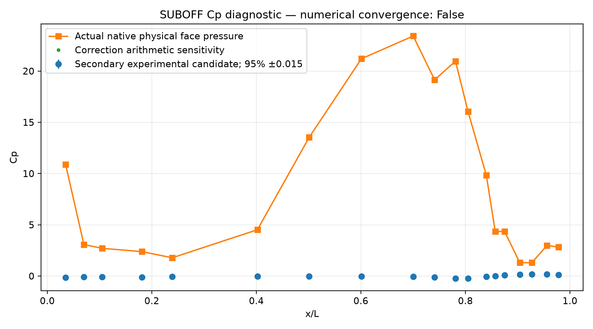
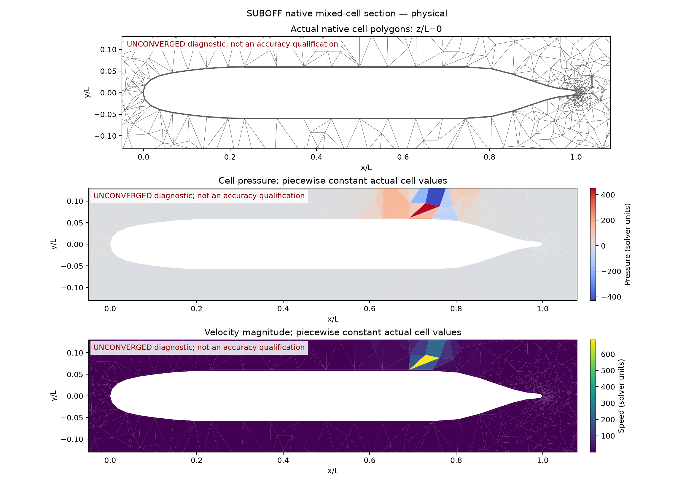
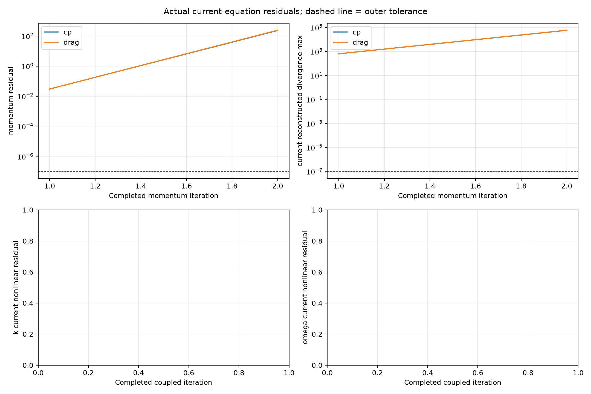
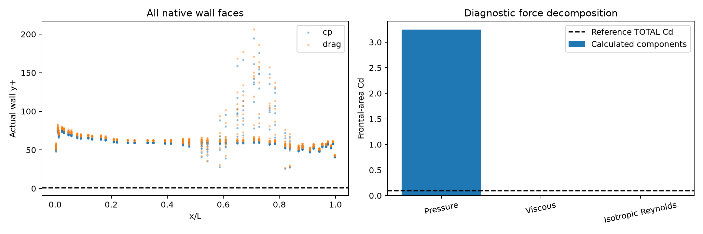

# SUBOFF AFF-1：纯贴体 FVM 物理基线

## 问题与验收目标

裸艇、零攻角、真实无滑移壁面；以 19 个表面压力测点的 Cp 曲线相对 L2 误差和总阻力 Cd 相对误差均小于 3% 为主要目标。
**本报告物理验收未通过。未收敛场的误差仅表示当前迭代场偏差，不是已收敛解的精度。**

## 工况、模型与软件设置

Cp 对照风洞 Re_L=1.2e7；阻力采用文献复现工况 U=3.046 m/s、rho=998.2 kg/m³、mu=0.001002 Pa s、L=4.356 m、D=0.508 m。
两项独立运行，未混用雷诺数。SST-2003，低 Re 近壁积分，无壁面函数；入流湍流强度 0.5%、长度尺度 0.05L 为建模假设。
未显式建立实验绊线，也未使用转捩模型。边界为来流速度、远场速度、物理压力出口 p=0；压力出口回流使用显式给定的来流速度和湍流量。
物理压力由 pi=p+2rho k/3 转换；Cd 包含压力和全部黏性/雷诺应力。运行配置与源代码快照保存于各计算目录。

| 工况 | 单元数 | Re_L | 动量步数 | 完整耦合步数 | 数值收敛 | 最大 y+ |
|---|---:|---:|---:|---:|---|---:|
| cp | 9,068 | 12000000 | 2 | 0 | False | 194.746 |
| drag | 9,068 | 13218056.8 | 2 | 0 | False | 206.501 |

## 主要对照结果

| 指标 | 当前结果 | 目标 |
|---|---:|---:|
| Cp 曲线相对 L2 偏差 | 9322.34% | <3% |
| Cp 绝对 RMSE | 11.6877 | 补充指标 |
| 计算 Cd | 3.2614372 | — |
| 参考 Cd | 0.093120813 | — |
| 总阻力相对偏差 | 3402.37% | <3% |
| 计算总阻力 | 3061.0731 N | 参考 87.4 N |

[逐点 Cp、差值及实际采样面编号](cp-taps.csv)。测点按真实三角壁面就近采样，未根据实验调整压力常数、平滑曲线或缩放结果。
Cp 参考为已保存的二级转录候选表，图中 ±0.015 为文献报告的绝对不确定度；表内修正差异另作敏感性比较。
阻力参考来自实验，密度和黏度属于公开 CFD 复现条件；Cd 使用迎流截面积，与湿表面积 Ct 不混用。

## 网格与真实场

表面结构化层、端部楔形、外部四面体，共形单域。图像使用真实单元与 z=0 平面的交线和原始单元值，无点云插值或平滑。

## 收敛、近壁与力分解

- cp: `{'type': 'RuntimeError', 'message': 'Explicit divergence guard exceeded: max speed 687.893 > 5; state retained without clipping'}`; state `momentum_only`.
- drag: `{'type': 'RuntimeError', 'message': 'Explicit divergence guard exceeded: max speed 702.174 > 5; state retained without clipping'}`; state `momentum_only`.

残差为当前原方程残差；线性求解成功或小迭代增量不能替代耦合收敛。低 Re SST 的 y+ 检查必须同时具备已收敛状态。
尚未完成三档网格或计算域独立性验证；CPU SciPy 运行，未开展本例 GPU 验证。

## 复现与原始证据

使用 `scripts/run_native_suboff_rans.py` 分别运行两个 Re；用 `scripts/compare_native_suboff_experiment.py --case cp/drag` 生成对应比较；本报告由 `scripts/report_suboff_physical_baseline.py` 从冻结数据生成。
具体迭代、离散、初始化与线性求解参数以每例 config.json 为准。summary.json 和 manifest.json 绑定输入及报告文件 SHA256。

- cp: [raw calculation](../cp-pseudo/report.md), [experimental comparison](../cp-pseudo-comparison/report.md).
- drag: [raw calculation](../drag-pseudo/report.md), [experimental comparison](../drag-pseudo-comparison/report.md).

参考：[Liu & Huang 实验报告](https://ntrl.ntis.gov/NTRL/dashboard/searchResults/titleDetail/ADA359226.xhtml)、[Cp 数据候选转录](https://zenodo.org/records/22692726)、[Morse & Mahesh 2023](https://doi.org/10.1017/jfm.2023.777)、[阻力复现工况](https://academic.oup.com/ooenergy/article/doi/10.1093/ooenergy/oiaf014/8405192)。
