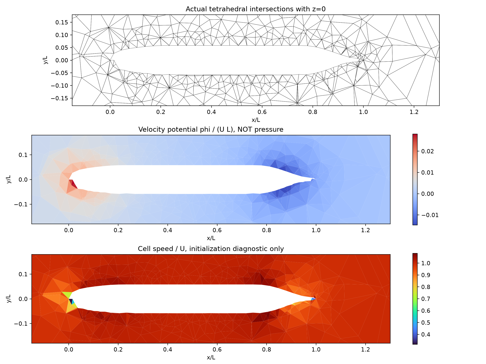

# SUBOFF native-mesh Hodge initialization diagnostic

**This is an inviscid initialization/mesh-operator diagnostic, not a viscous SUBOFF benchmark. The scalar is velocity potential, not physical pressure.**

## Problem and software

Actual bare SUBOFF tetrahedra are read from `docs/verification-suboff-mesh/source-bound-coarse/suboff.msh` (SHA256 `254dc5060def74185896d97a93bb7d0e9e417796ec2c43749bb46264d4b9c025`). The native 3D mesh has 6,810 cells and 14,384 unique shared faces. No extrusion, cylinder topology or Cartesian mask is used. Starting from uniform U=(1,0,0), solve the mixed-boundary velocity-potential Poisson problem, then correct native face flux. At the wall dphi/dn=U dot n removes penetration; inlet/farfield derivative zero preserves their normal flux, and outlet phi=0 anchors the system. The whole skew/nonorthogonal face response is assembled with mixed LS boundary rows and CPU sparse LU. One scalar face traction supplies a conservative Gauss cell correction.

```bash
OMP_NUM_THREADS=1 OPENBLAS_NUM_THREADS=1 MKL_NUM_THREADS=1 PYTHONPATH=src python scripts/initialize_suboff_native.py --mesh docs/verification-suboff-mesh/source-bound-coarse/suboff.msh --output NEW_EMPTY_DIRECTORY
```

## Actual mesh and fields



These polygons are true tetrahedral intersections, not projected edges or interpolated raster cells. Raw native fields and topology are in fields.npz. No pressure or Cp/drag curve is inferred from velocity potential. No physical time has advanced; the velocity represents a slip potential initialization, not a no-slip viscous solution.

## Native projection checks

| Metric | Actual | Limit | Passed |
| --- | ---: | ---: | --- |
| native_projected_divergence | 1.7369e-12 | 1e-07 | True |
| wall_native_normal_speed | 8.86317e-17 | 1e-12 | True |
| fixed_outer_flux_change | 0 | 1e-12 | True |
| conservative_potential_impulse_ledger | 2.60209e-17 | 1e-10 | True |

Independent mixed-BC affine manufacture phi=1.2+0.7x−0.3y+0.2z on this exact mesh: scalar error 4.59632e-14, gradient error 1.20126e-13, final flux remainder 4.32987e-15. Analytic boundary data are supplied on all physical faces.

## Unresolved cell/face consistency

Native projected divergence is 1.7369e-12 U/L. Re-interpolating the corrected conservative cell velocity gives divergence 80.8469 U/L and maximum interior normal speed difference 0.163332 U. These are exposed separately: successful face projection does not certify a coupled incompressible Navier--Stokes solver. Numerical flow and physical qualification remain false.

## Performance and next stage

Setup 7.1857 s; one solve 0.0106 s. The actual full nonorthogonal matrix has 98,382 entries and L/U factors have 3,099,450 entries (37.248 MB sparse arrays). These are measured CPU reference costs, not GPU or engineering-scale performance.

Next: conservative low-Re viscous momentum on the native mesh with matching wall pressure response; independent cell/face and stress verification; boundary-layer/wake refinement; then matched experimental Reynolds and original reference data. The present tetrahedral meshes have no prism boundary layer. geometry/operator/projection checks do not imply drag accuracy or mesh independence.
