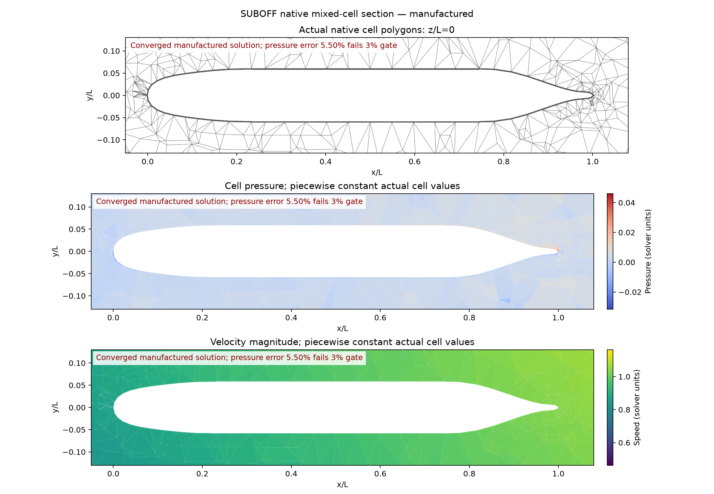
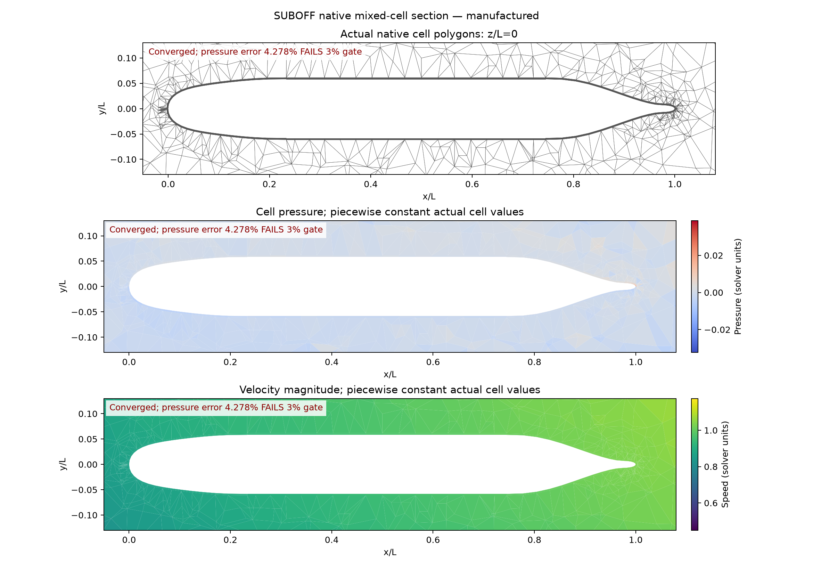

# SUBOFF validation development: all requested metrics

## Scope and acceptance

The required targets are experimental total drag, measured surface pressure
coefficient, and independent three-dimensional nonlinear manufactured-solution
verification. Every numerical error target is **strictly below 3%**. A small
continuity residual is not an accuracy metric. Geometry checks, manufactured
verification, numerical RANS convergence, and experimental validation have
separate acceptance flags.

**The complete physical SUBOFF benchmark is not yet qualified.** The fixed
three-dimensional ABC manufactured solution has passed on its fine grid with
monotonic spatial refinement. No experimental SUBOFF drag or Cp result has
been accepted.

| Evidence | Actual outcome | Scope |
|---|---|---|
| [3D nonlinear ABC, 27 / 216 / 1,728 cells](../verification-native-abc3d-spatial/report.md) | Fine velocity vector 0.0240%, components 0.0287% / 0.0235% / 0.0195%, pressure 2.9124%; all errors decrease | Fine-grid manufactured spatial verification passes; coarse/medium pressure fails |
| [Native SST nonzero 3D channel](../verification-native-rans3d/report.md) | Original nonlinear gates pass for pseudo dt 0.1 / 1 / 10, with 57 / 19 / 16 outer iterations | Numerical coupling verification; no experimental accuracy target |
| [SUBOFF mixed-grid ABC, 11,648 cells](../verification-native-suboff-mms/coarse/report.md) | Converged in 55 updates; velocity vector 0.1979%, pressure 5.4999% | Pressure fails the 3% gate |
| [SUBOFF mixed-grid ABC, 24,284 cells](../verification-native-suboff-mms/medium/report.md) | Converged in 42 updates; velocity vector 0.1461%, pressure 4.2777% | Pressure fails the 3% gate; two meshes do not establish a three-grid convergence study |
| [Adaptive wall geometry](../verification-suboff-adaptive-mesh/report.md) | 22,436 cells; actual sampled wall-facet error 2.54955e-4 L | Geometry only |
| [Wall-resolved planning mesh](../verification-suboff-wall-resolved-mesh/report.md) | 103,278 positive-volume cells; 24 structured wall layers | Geometry only; actual flow y+ and physical accuracy unverified |
| [Experimental reference and specification](../verification-suboff-reference/README.md) | Frozen total force and 19 candidate Cp taps with provenance/uncertainty | Reference and comparison infrastructure, not calculated flow |

## Numerical method

The shared native finite-volume mesh supports actual hexahedra, wedges and
tetrahedra with a conforming triangular interface. Warped faces are integrated
as explicit planar facets. Momentum contains the full molecular/eddy deviatoric
stress and conservative pressure force. Cell and face velocities are coupled
with a pressure-flux defect based on the **same conservative momentum gradient**.
The convergence check replays current momentum, current reconstructed mass flux,
stored mass flux, and their face consistency after every nonlinear update.

SST-2003 follows the [official model definition](https://tmbwg.github.io/turbmodels/sst.html#sst-2003),
including exact production and its limiter. The solver uses pi=p+2rho k/3;
physical pressure and isotropic Reynolds stress are converted consistently when
reporting forces. Nearest-wall distances are exact distances to actual wall
triangles, not nearest face-center distances. Current nonlinear k/omega sources
are recomputed; frozen linearized source ledgers are not convergence evidence.

The ABC forcing is derived independently from the continuum Navier–Stokes
equations, with fixed amplitude 0.5, wavenumber 0.7 and nu=0.1. All three velocity
components are nonzero; the vector field and pressure vary in all three spatial
directions. No reference velocity or
pressure is used as an initial solution, and no production operator residual
defines the manufactured forcing. Relative L2 uses actual control-volume
weights and values at volume centroids; pressure means are removed explicitly.
This is not an exact cell-average error norm. The SUBOFF manufactured hull has
nonzero prescribed velocity and is not a no-slip physical submarine experiment.

## Physical reference conditions

Two independent experimental operating points are used; matching their Reynolds
numbers artificially would change the experimental comparison.

- Total drag: AFF-1 bare hull, zero incidence, L=4.356 m, D=0.508 m,
  U=3.046 m/s, rho=998.2 kg/m³, mu=0.001002 Pa s, Re_L=13,218,056.81;
  experimental force 87.4 N. Fluid properties are an independently published
  [replication setup](https://academic.oup.com/ooenergy/article/doi/10.1093/ooenergy/oiaf014/8405192),
  not retroactively verified original tank-temperature measurements. Total force
  includes physical pressure, anisotropic stress and isotropic Reynolds stress.
  Frontal-area Cd is 0.093120813 when derived from those stated conditions;
  wetted-area Ct and residual resistance CR are different quantities.
- Cp: AFF-1 zero incidence, Re_L=12,000,000, 19 upper-meridian taps,
  Cp=(p-p_inf)/(0.5rho U²). The [secondary data](https://zenodo.org/records/22692726)
  remain unmodified. Three correction discrepancies are retained; both the listed
  corrected column and measured-minus-empty-tunnel sensitivity are compared.
  Reported 95% Cp uncertainty is ±0.015 absolute; a nominal 3% curve error does
  not eliminate that uncertainty. The full original pressure table remains
  unverified.

The comparison module rejects mismatched Reynolds numbers and manufactured
solutions presented as physical SUBOFF runs. Total force is replayed from raw
native face pressure and stress. Cp sampling retains selected actual wall-facet
IDs, true nearest-triangle geometry offsets, and the reference-pressure choice;
there is no fitted pressure offset or filtered cloud used to obtain agreement.

## Actual fields and error diagnosis



The [independent reconstruction audit](../verification-native-suboff-mms/reconstruction-audit/report.md)
replays the converged coarse field using its frozen producer sources. Almost
all of the volume-weighted pressure error is in the exterior tetrahedral region;
the structured/tetra interface is not the dominant global contribution.
Improving only the near-wall sampling does not establish pressure accuracy.

A read-only quadratic-neighbor experiment reduces pressure-force consistency
error from 2.3576% to 0.1891%. It does **not** modify the production solver or
calculate a new NS pressure solution, so it cannot be counted as passing the
SUBOFF pressure gate. A production change must preserve shared-face conservation
and update the pressure/velocity coupling consistently before actual re-solving.



Refining from 11,648 to 24,284 cells reduces pressure error from 5.4999%
to 4.2777%, but both fail. These two levels alone do not establish an
asymptotic convergence rate. A reusable quadratic reconstruction module now
passes seven tests for polynomial reproduction and actual triangular face
integration. It has not yet been coupled into a new converged SUBOFF solve.

## Cost, failed attempts, and remaining work

[Linear solver diagnostics](../verification-native-suboff-linear/report.md)
retain the failed 6,000-iteration block GMRES attempt. A sparse SIMPLE Schur
approximation with exact velocity factors solves the first linearization in
238 iterations, true relative residual 5.30e-11, and 154.31 seconds. One update
does not establish nonlinear convergence or 100,000-cell scalability. The
converged 11,648-cell manufactured SUBOFF run took 822.20 seconds on the CPU.
The 24,284-cell run took 1,837.11 seconds and 42 nonlinear updates.
GPU acceleration of these new native 3D paths has not been tested.

Next required gates are exterior-mesh/discretization convergence, suitable
actual wall y+ for wall-resolved SST, robust large-grid linear solves, physical
SST SUBOFF convergence, and independent drag/Cp comparisons on refined meshes.
Inflow turbulence and experimental tripping must be documented rather than
tuned against the reference force. These are outstanding development tasks,
not accepted accuracy claims.

## Reproduction

```bash
export OMP_NUM_THREADS=1 OPENBLAS_NUM_THREADS=1 MKL_NUM_THREADS=1 PYTHONPATH=src
python scripts/verify_native_abc_convergence3d.py --help
python scripts/run_native_suboff_benchmark.py --mesh INPUT.msh --output EMPTY_MMS_DIRECTORY
python scripts/run_native_suboff_rans.py --mesh INPUT.msh --reynolds 13218056.809580836 --output EMPTY_DRAG_DIRECTORY
python scripts/compare_native_suboff_experiment.py --run EMPTY_DRAG_DIRECTORY --case drag --output EMPTY_COMPARISON_DIRECTORY
python scripts/plot_native_suboff_fields.py --mesh INPUT.msh --fields FIELDS.npz --output EMPTY_FIGURE_DIRECTORY
```

Every completed report binds its actual input, raw fields, configuration,
source snapshots and hashes. The coarse probe's after-completion archival
timing is explicitly disclosed. [Full regression output](pytest-output.txt)
records **282 passed**, three library warnings and 45 subtests.
