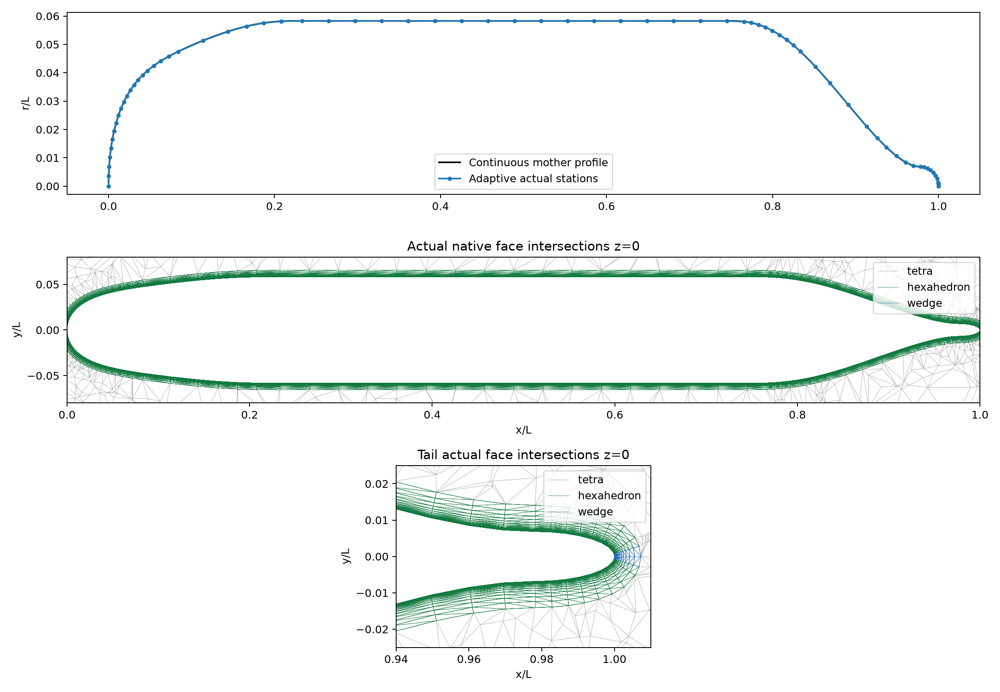
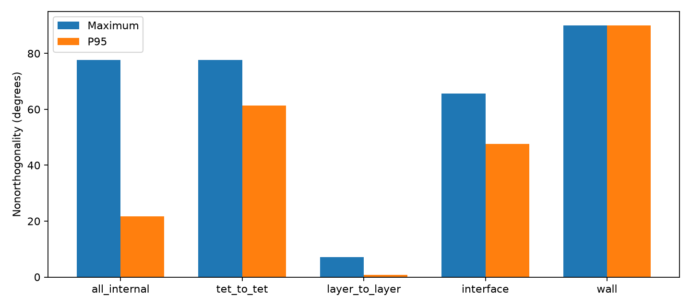

# SUBOFF mesh for wall-resolved SST planning

## Scope and fixed requested parameters

This is an actual mesh-generation and geometry-audit result, not an SST flow calculation. Mother-profile chord target **0.0001 L**, maximum axial spacing **0.035 L**, **48 azimuthal stations**, **24 normal layers**, unchanged first full layer height **4e-06 L**, growth **1.3**, total normal thickness **0.0072240103 L**. Gmsh exterior size is 0.3 L. No first-height adjustment was made to meet an estimated y+ threshold. No earlier mesh artifact is overwritten.

Actual adaptive axial stations: **71**. These settings already imply **80,640 structured layer cells**; the total actual native control volume count is **103,278**. This exceeds the initial ~60k estimate because the requested 71 stations × 48 sectors × 24 layers alone consume more than 80k cells. No flow solver was run as part of this mesh task. Generation/import runtime was 487.430 seconds on the available shared CPU workload, not an isolated performance benchmark.



## Thin-layer positivity and interface closure

| Cell type | Actual cells | Minimum volume / L³ | All volumes positive |
|---|---:|---:|---|
| hexahedron | 78,336 | 3.82843e-13 | True |
| tetra | 22,638 | 1.03163e-09 | True |
| wedge | 2,304 | 1.17864e-13 | True |

Maximum relative cell face closure **4.69118e-16**; minimum face S·d **5.88616e-14**. **6624** native interface triangles exactly share structured/exterior adjacency; no interpolation interface. Maximum affine operator audit error **3.12793e-10**. These are geometric and affine operator checks only. High aspect ratio and roundoff sensitivity remain material risks at this first height.

## Actual surface geometry

Ten points per actual triangular native wall facet include vertices, edges and interior locations. Maximum sampled interior closest distance to the continuous mother profile is **0.000219584 L**; maximum sampled node distance **4.99657e-09 L**. Dense meridian chord distance is **9.85336e-05 L**. The angular midbody sagitta is **0.000124844 L**. Exact nodes do not certify planar-face geometry. These are finite sampled diagnostics, not a continuous Hausdorff certificate and not a flow error estimate.

## Grouped face quality

| Face group | Maximum nonorthogonality | P95 |
|---|---:|---:|
| all_internal | 77.5821° | 21.6969° |
| tet_to_tet | 77.5821° | 61.3550° |
| layer_to_layer | 7.1738° | 0.8094° |
| interface | 65.6745° | 47.7060° |
| wall | 89.9791° | 89.9791° |



High wall-facet angles arise partly from triangle face centers displaced tangentially from the adjacent large-aspect hexahedral cell center. This explanation does not exempt wall-gradient or pressure traction operators from verification. Exterior and interface angles still require a numerical sensitivity check. Actual wall centroid-to-facet normal projections range from **1.9671e-06** to **1.99731e-06 L**, median **1.9957e-06 L**. This is a geometry diagnostic; it is not the exact nearest-surface distance used by a qualified SST implementation.

## Estimated y+ — assumptions and failed estimate retained

Assume **Cf=0.003**, Uref uniform, u_tau/Uref=sqrt(Cf/2), and a flat first-cell center at half the full first layer height: y/L=h/(2L)=2e-6. Then y+≈Re_L sqrt(Cf/2) h/(2L). This uses no computed wall traction.

| Intended observable | Re_L | Estimated first-center y+ | Comparison |
|---|---:|---:|---|
| Cp | 1.2e+07 | 0.929516 | below 1 |
| drag | 1.321806e+07 | 1.023866 | above 1 |

The drag-Re estimate remains above 1. This is retained transparently, without changing h to pass a planning threshold. Neither estimated value qualifies actual y+. A final solution must compute local wall traction and its u_tau, use a verified wall-distance definition, examine the spatial y+ distribution, then decide whether to refine. Total band thickness also requires comparison to the actual boundary layer; 24 layers alone do not certify SST resolution. No drag/Cp experiment error below 3%, RANS convergence or GPU acceleration is claimed.

## Reproduction and evidence

```bash
OMP_NUM_THREADS=1 OPENBLAS_NUM_THREADS=1 MKL_NUM_THREADS=1 PYTHONPATH=src /data/TensorFEM/.venv/bin/python scripts/prepare_suboff_adaptive_mesh.py --output NEW_EMPTY_DIRECTORY --chord-tolerance .0001 --maximum-spacing .035 --azimuthal 48 --layers 24 --first-height .000004 --growth 1.3 --far-size .3
OMP_NUM_THREADS=1 OPENBLAS_NUM_THREADS=1 MKL_NUM_THREADS=1 PYTHONPATH=src /data/TensorFEM/.venv/bin/python scripts/audit_suboff_adaptive_quality.py --geometry NEW_EMPTY_DIRECTORY/native-geometry.npz --output NEW_EMPTY_QUALITY_DIRECTORY
OMP_NUM_THREADS=1 OPENBLAS_NUM_THREADS=1 MKL_NUM_THREADS=1 PYTHONPATH=src /data/TensorFEM/.venv/bin/python scripts/report_suboff_wall_mesh.py --case NEW_EMPTY_DIRECTORY --quality NEW_EMPTY_QUALITY_DIRECTORY --output NEW_EMPTY_REPORT_DIRECTORY
```

The [generator report](attempt-01/report.md) preserves original launch source snapshots, `.msh`, geometry NPZ, config, sampled audit, PNG/PDF and SHA256 manifest. The grouped audit binds that NPZ SHA. This supplemental report binds both audit JSON inputs and includes its report producer source. Original TensorLBM geometry attribution and independent offset-table limitation remain as documented in the generator. Planning tests passed: **2** (`tests/test_suboff_wall_mesh_planning.py`), checking the half-layer center definition and transparent drag-Re estimate above 1. Test source is archived with this report. Geometry passed: **True**; actual y+/SST flow/experimental accuracy qualified: **False**.

The plotting producer in this run retained its launch snapshot. A later script optimization reads actual wall vertices directly, avoiding a repeated structured-layer preflight for plotting. The recorded 487.43 s generation/import duration excludes figure-production overhead and is not a flow-solver timing.
