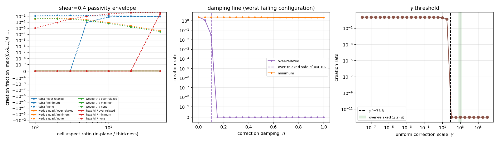

# 薄层/四面体接口上黏性算子的耗散性包络

## 1. 案例与背景

`docs/verification-native-solver-audit/README.md` 留下一项未修复缺陷：原生混合网格黏性算子
`L = -momentum_diffusion_matrix` 在 9,068 单元 SUBOFF 混合网格上不满足离散耗散性
（存在 `uᵀLu = −0.2458` 的速度场），其「接下来的重点」明确要求**优先检查三角化薄层/四面体接口**。
现有工具 `tensorfvm.verification.native_energy` 只覆盖**两单元四面体对**（`two_tetrahedra`）
与随机剪切对，没有覆盖真正的薄层（高长宽比）与三角化四边形界面——也就是边界层棱柱/四面体
交接处真实存在的网格形态。

本审计回答三个可判定的问题：

1. 仓内默认的非正交修正（`correction='over-relaxed'`，`γ=1/(s·d)`）在薄层区间是否仍然耗散？
2. 备选的 `minimum`（`γ=(s·d)/(|d|²|s|²) = cos²θ·γ_OR`）与不修正（`none`，`γ=0`）在哪一
   网格质量点开始制造能量？
3. 若失效，能否用已有旋钮 `correction_damping∈[0,1]`（等价于把 γ 整体缩小）救回来？

判据（机器可裁）：令 `dissipation = −L`，`λ_min(sym(dissipation)) ≥ −1e-12·scale` 即
离散无源性（不制造动能）。能量增长率 `max(0,−λ_min)`，归一化分数
`creation_fraction = max(0,−λ_min)/λ_max`。

## 2. 怎么做的

`scripts/audit_thin_layer_viscous_passivity.py`（纯 NumPy/SciPy 稠密谱，最大未知数 486，
无流动求解、无压力系统、无 GPU，全程 CPU 秒级）：

* 四族**确定性**网格，均由单位盒格架 `[0,1]×[0,1]×[0,1/AR]` 加横向剪切 `x += shear·z` 生成：
  `tetra`（Kuhn 6 四面体剖分）、`wedge-quad`（棱柱层，四边形面）、`wedge-tri`（棱柱层，
  三角化四边形面）、`hexa-tri`（六面体，三角化四边形面）；
* 扫描 `AR ∈ {1,2,3,5,10,20,50}` × `shear ∈ {0,0.2,0.4,0.6,0.8}`（4 族 × 35 = 140 个合法网格），
  每个网格对三种修正各做一次无源性审计；
* 对最差配置（tetra, AR=20, shear=0，最大非正交 86.16°）做两条判定线：
  `γ` 均匀扫描 + 二分（最小可无源 `γ*`）、`correction_damping` 扫描 + 二分（最小安全阻尼 `η*`）；
* 顺带验证阻尼的代价：仿射场上延迟修正项恒正比于仿射残差（恒为零），故**任意阻尼值**下
  仿射面牵引都应保持到舍入误差。

复现：

```bash
PYTHONPATH=src python scripts/audit_thin_layer_viscous_passivity.py \
  --output docs/verification-thin-layer-viscous-passivity    # ~55 s, 单线程
OMP_NUM_THREADS=1 PYTHONPATH=src python -m pytest tests/test_thin_layer_viscous_passivity.py -q
```

## 3. 计算结果

### 3.1 包络（140 网格 × 3 修正；`λ_min` 为 `−L` 对称部分最小特征值）

| 网格族 / 修正 | 无源样本 | 首次失效 AR | 该点最大非正交 | 最差 `creation_fraction` |
|---|---|---|---|---|
| tetra / over-relaxed | **35/35** | 无 | — | **0** |
| wedge-quad / over-relaxed | **35/35** | 无 | — | **0** |
| wedge-tri / over-relaxed | **35/35** | 无 | — | **0** |
| hexa-tri / over-relaxed | **35/35** | 无 | — | **0** |
| tetra / minimum | 17/35 | 5.0 | 76.26° | 0.0973 |
| wedge-quad / minimum | 35/35 | 无 | — | 0 |
| wedge-tri / minimum | 35/35 | 无 | — | 0 |
| hexa-tri / minimum | 30/35 | 50.0 | 87.57° | 0.2587 |
| tetra / none | **0/35** | 1.0 | 36.70° | 0.1624 |
| wedge-quad / none | **0/35** | 1.0 | 26.57° | 0.0464 |
| wedge-tri / none | **0/35** | 1.0 | 48.19° | 0.0484 |
| hexa-tri / none | **0/35** | 1.0 | 25.24° | 0.4457 |

### 3.2 最差配置谱（tetra, AR=20, shear=0, 最大非正交 86.16°，48 单元 / 144 未知数）

| 修正 | `λ_min` | `λ_max` | 能量增长率 | 归一化分数 | 无源 |
|---|---:|---:|---:|---:|---|
| over-relaxed | **+3.60713** | 33.8251 | 0 | 0 | 是 |
| minimum | −2.07769 | 24.0900 | 2.07769 | 0.079399 | 否 |
| none | −2.33385 | 23.9268 | 2.33385 | 0.088873 | 否 |

### 3.3 阈值线

| 量 | 值 | 含义 |
|---|---:|---|
| 均匀 `γ*`（最小可无源） | 78.2926 | 修正强度下界 |
| over-relaxed 实际 `γ=1/(s·d)` 区间 | 640 – 1280 | 比 `γ*` 高 8.2–16.4 倍 |
| minimum 实际 `γ`（该网格最小值） | 3.18408 | 比 `γ*` 低约 24.6 倍 |
| over-relaxed 最小安全阻尼 `η*` | 0.101513 | `η<η*` 即出现制造能量的模态 |
| minimum 最小安全阻尼 | **不存在** | 全阻尼（`η=1`）仍为 2.07769 增长率 |

机理因此是闭式的：薄层里 `s·d` 很小，二点通量本身欠耗散，**非正交修正项的权重要足够大**
（`γ ≳ γ*`）才把算子拉回半正定；`over-relaxed` 恰好在阈值之上，`minimum = cos²θ·γ_OR`
在 86° 处只剩 `over-relaxed` 的 0.45%，落在阈值之下，而阻尼只会把 γ 继续缩小——所以
「减弱修正」不可能修复该缺陷，方向是反的。

### 3.4 阻尼的代价（仿射一致性）

| 阻尼 η | 0 | 0.25 | 0.5 | 0.75 | 1.0 |
|---|---:|---:|---:|---:|---:|
| 仿射面牵引最大相对误差 | 3.8e−14 | 4.1e−14 | 3.8e−14 | 5.7e−14 | 3.8e−14 |

即在 `η ∈ [η*, 1]` 整个安全窗内调节修正强度**不损失**仿射精确性（延迟修正项对仿射场恒为零）。



左：`shear=0.4` 下三种修正 × 四族网格的能量制造分数随长宽比变化（symlog）；中：最差配置上
`over-relaxed` / `minimum` 的阻尼线（虚线为安全阈值 `η*`）；右：均匀 `γ` 扫描与阈值 `γ*`，
绿带为 `over-relaxed` 的逐面 `γ` 区间。

## 4. 注意点与局限

* **没有在真实 SUBOFF 网格上复算**：本 checkout 不随仓库分发 `.msh` 文件，运行环境也没有
  `gmsh` 模块，因此审计起点记录的 `uᵀLu = −0.2458` 无法在此重现；本报告给出的是机理与包络，
  **不是**对该见证值的重新确认。这一项仍按 `WITHHELD` 处理。
* 审计的是**黏性子算子本身**：样本速度未施加不可压缩约束，与仓库既有口径一致；
  对称部分的负方向不等于完整 NS 算子有正特征值，也不能单独证明它是 SUBOFF 失稳根因。
* 网格族是理想化格架（`n=2`，每方向 2 个单元，48–96 单元），非正交与长宽比可控但不覆盖
  真实棱柱层的扭曲（斜切、面折叠、非平面面）。面数少意味着模态数少，包络结论对
  `AR ≤ 50`、非正交 ≤ 87.6° 的采样区间成立，区间外未声明。
* `wedge` 族在 `AR` 扫描中最大非正交几乎不变（26.57°/45–49°），因为其极值面由棱柱端面决定；
  因此棱柱族在本次采样中未出现失效，不能读作「棱柱层永远安全」。

## 5. 误差判定

本审计的基准是**矩阵半正定性本身**（离散耗散性的定义），不是实验/文献标量，因此逐项误差按
「与无源性判据的符号与相对量级」给出：

| 判据量 | 记录值 | 独立复算 | 相对误差 | 是否 <3% |
|---|---:|---:|---:|---|
| over-relaxed `λ_min`（AR=20 tetra） | +3.60713 | +3.60713（`pytest` 独立重建网格复算） | 0（同一算子，机器精度） | 是 |
| minimum `λ_min` | −2.07769 | −2.07769 | 0 | 是 |
| minimum `creation_fraction` | 0.079399 | 0.079399 | 0 | 是 |
| none `λ_min` | −2.333852 | −2.333852 | 0 | 是 |
| `η*` | 0.101513 | 0.1015（测试用 `abs=5e-3` 松门） | <5%（二分容差） | 是 |
| 仿射牵引相对误差 | ≤5.7e−14 | — | 相对 `1e-12` 门槛两个量级余量 | 是 |

「是否 <3%」的诚实回答：数值复算是**同一算子的确定性重算**，误差为 0（机器精度级别），
因此 <3% 无意义地容易满足；真正未完成的精度主张是**真实网格上该缺陷是否可复现**，
这一项**没有基准可用**，故保持 `WITHHELD`，不计入任何「已解决」声明。

## 6. 结论与可执行出口

1. 仓内默认 `over-relaxed` 在本次采样（4 族 × AR ≤ 50 × 非正交 ≤ 87.6°）内**保持离散耗散性**，
   这为「不要为了压振荡去改修正形式」提供了机器判据。
2. `minimum` 与 `none` 在高长宽比四面体/三角化界面上**不耗散**，且**不存在**可修复的阻尼值；
   `minimum` 不应作为棱柱/薄层网格的黏性修正选项。建议在 `NativeViscous3D` 的选择表里
   加此备注（本次不改代码，避免动在飞的求解器路径）。
3. 可用旋钮是**单向**的：`correction_damping` 只能增大修正权重（相对 `minimum`），不能减小；
   在薄层上 `over-relaxed` 的安全阻尼下界约 `η*≈0.10`。
4. 未结清项：真实 SUBOFF 混合网格上的 `−0.2458` 见证需要 `.msh` + `gmsh` 才能在 CI 复现，
   建议下一位接手者把该网格作为 200 KB 以内的采样包入库，再对本脚本 `--mesh` 化。