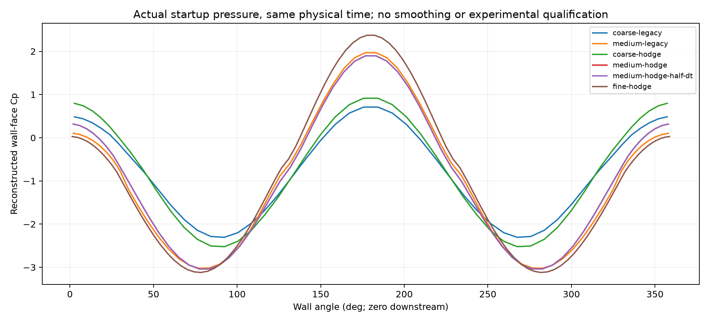
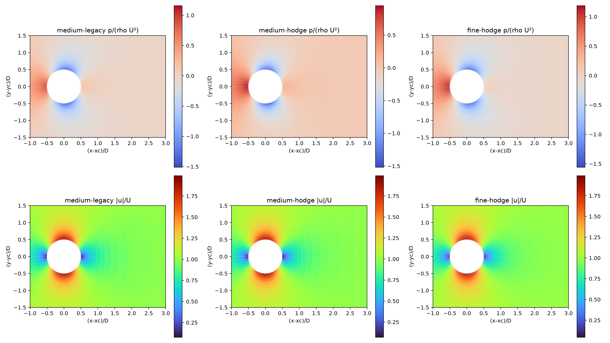
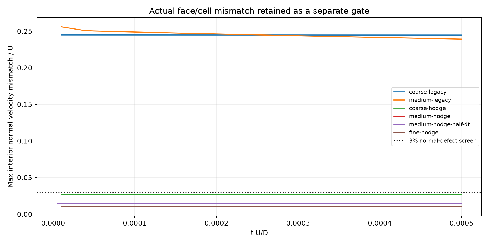
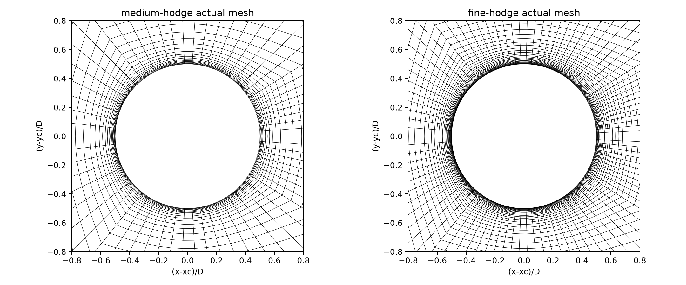

# Three-dimensional transient pressure–velocity compatibility

**Restricted initialization correction. Numerical and physical qualification remain false.**

## Problem and pressure boundary conditions

Uniform cell velocity combined with zero wall face flux is not an incompressible initial state around an impermeable cylinder. The previous startup projects that mismatch while imposing a homogeneous pressure normal derivative, also used in its LS and wall-traction reconstruction. This creates an inconsistent cell impulse even when the native face divergence is small.

A boundary pressure gradient may be nonzero when it is needed to achieve the prescribed boundary mass flux. The official OpenFOAM `fixedFluxPressure` boundary type expresses this principle; this implementation is an independently derived static shared-face projection, not a port of the OpenFOAM solver.

[Official OpenFOAM boundary source](https://github.com/OpenFOAM/OpenFOAM-dev/blob/master/src/finiteVolume/fields/fvPatchFields/derived/fixedFluxPressure/fixedFluxPressureFvPatchScalarField.H)

## Conservative correction

For the startup velocity potential phi, q_new = q_raw − grad(phi)·S. The Neumann condition on impermeable faces is d(phi)/dn = (q_raw − q_target)/|S|, with q_target=0. Other flux boundaries use their prescribed data; the outlet potential is zero. Its correction scale is one and does not depend on dt or density. Cell velocity changes only by −V⁻¹ sum(phi_face S), with one traction per shared face. The domain impulse therefore equals the physical boundary potential traction. Phi is archived separately from pressure. Time remains zero and no force/history sample is fabricated. Tangential no-slip is subsequently imposed by viscous boundary stress; a Hodge projection alone cannot create a resolved viscous startup layer.

The same supplied derivative enters three places: the LS normal-derivative row, the nonorthogonal pressure face flux, and the normal displacement contribution to face pressure. Nonzero outlet Dirichlet data enter both the Poisson RHS and the outlet gradient/traction. Default physical-step Neumann data remain homogeneous; the optional startup correction is not a complete momentum-compatible wall-pressure solver.

## Independent manufactured response

The manufacture p=.7x−.3y+.2 prescribes its actual face-normal derivative and actual outlet pressure on the real 48×16×4 body-fitted mesh. A complete Poisson solve removes its constant pressure impulse from both cell momentum and native face flux. This independently prescribed affine solution checks the boundary and interior operators; it is not a Re3900 flow reference.

| Manufactured metric | Actual value | Gate | Passed |
|---|---:|---:|---|
| all_cell_affine_pressure_gradient_error | 7.23865e-14 | 1e-10 | True |
| all_face_affine_pressure_value_error | 3.55271e-15 | 1e-10 | True |
| all_face_affine_pressure_flux_error | 8.33361e-15 | 1e-10 | True |
| solved_affine_pressure_error | 3.08811e-10 | 1e-08 | True |
| corrected_cell_velocity_max_error | 4.78958e-11 | 1e-08 | True |
| corrected_native_face_flux_max | 1.38481e-10 | 1e-08 | True |
| native_divergence_max | 8.76337e-11 | 1e-10 | True |

Applying homogeneous Neumann data to this different boundary problem produces face-pressure error 16.7056 and LS gradient error 3.14399. These are incompatibility diagnostics, not fair errors for the homogeneous-boundary PDE.

## Actual Re3900 startup experiments

All cases solve shared-face transport and pressure projection to tU/D=0.0005, with WALE, upwind fraction .1, and the same original .001 perturbation before optional projection. Legacy versus Hodge starts have different initial cell fields by construction. Time-step response compares complete Hodge runs from bitwise identical projected initial fields. Coarse/medium/fine meshes differ in angular, radial, spanwise resolution and stretching, so no asymptotic convergence order is assigned.

| Case | Cells | Native divergence | Cell interpolation divergence | Max normal defect / U | Momentum ledger | All gates |
|---|---:|---:|---:|---:|---:|---|
| coarse-legacy | 6144 | 7.49666e-10 | 4.56923 | 0.244669 | 7.9275e-15 | False |
| medium-legacy | 24576 | 8.56954e-09 | 122.726 | 0.239047 | 2.07052e-15 | False |
| coarse-hodge | 6144 | 5.30609e-09 | 0.415226 | 0.0271173 | 6.81312e-15 | False |
| medium-hodge | 24576 | 2.50805e-09 | 3.87587 | 0.0142811 | 2.56667e-15 | False |
| medium-hodge-half-dt | 24576 | 7.65657e-09 | 3.87593 | 0.0142811 | 1.02242e-15 | False |
| fine-hodge | 55296 | 2.72777e-09 | 3.6261 | 0.0101762 | 3.29585e-16 | False |









## Grid and complete time-step responses

Wall pressure means use actual wall-face pressures from the conservative traction, area-weighted over span at each angle. Spatial curves are compared by periodic interpolation of the coarser angular samples. Relative L2 is norm(coarse−fine)/norm(fine), not agreement with experiment. The actual metric values and definitions are saved in summary.json.

```json
{
  "legacy_coarse_to_medium": {
    "wall_face_cp_relative_l2": 0.4188988520134364,
    "definition": "norm(periodic_interp(first)-second)/norm(second)",
    "reference": "internal sensitivity only, not experiment"
  },
  "hodge_coarse_to_medium": {
    "wall_face_cp_relative_l2": 0.3531011887256109,
    "definition": "norm(periodic_interp(first)-second)/norm(second)",
    "reference": "internal sensitivity only, not experiment"
  },
  "hodge_medium_to_fine": {
    "wall_face_cp_relative_l2": 0.14761552896627503,
    "definition": "norm(periodic_interp(first)-second)/norm(second)",
    "reference": "internal sensitivity only, not experiment"
  },
  "hodge_complete_dt_to_half_dt": {
    "wall_face_cp_relative_l2": 0.00015680252850986453,
    "definition": "norm(periodic_interp(first)-second)/norm(second)",
    "reference": "internal sensitivity only, not experiment"
  },
  "dt_independent_projected_initial_fields_bitwise_identical": true,
  "asymptotic_grid_convergence_qualified": false
}
```

## Remaining failures and scope

Normal mismatch may pass a 3% local screen while the separate interpolated-cell divergence screen fails. Both remain visible. Small native continuity and a global momentum ledger do not qualify the cell/face coupling or the physical pressure. The face-history predictor preserves any remaining initial interpolation defect and integrates the difference of cell and face pressure operators. This patch does not eliminate that mechanism, provide a full mimetic pressure–velocity pair, or prove long-time compatibility. No physical Re3900 Cp, drag, Strouhal, LES, CUDA, or SUBOFF accuracy claim is made. Existing failed reports and raw fields remain unchanged.

## Reproduction

```bash
export PYTHONPATH=src OMP_NUM_THREADS=1 OPENBLAS_NUM_THREADS=1 MKL_NUM_THREADS=1
/data/TensorFEM/.venv/bin/python scripts/verify_transient_pressure_compatibility.py --output results/transient-pressure-compatibility
```

Each case has common Metric/evaluate/save_run outputs, actual fields.npz, history.json/CSV and result.json. The producer snapshot and SHA256 manifest cover solver, mesh parents, report script and tests. Raw fields include pre- and post-step velocities, face momentum terms, actual pressure traction, mesh connectivity, initial velocity potential and native flux. Independent NumPy face-scatter checks the last local and global momentum balance and both divergence definitions. The report does not smooth cells or alter numerical results.
