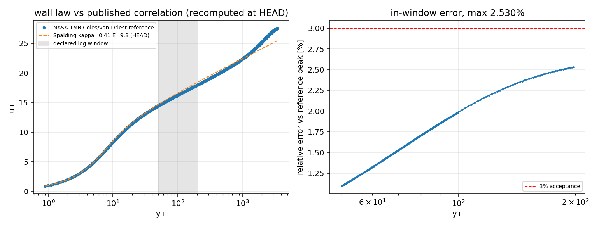

# HEAD 复算记录：壁面函数 vs NASA TMR Coles 关联式（2026-11-08）

## 1. 为什么有这个文件

`docs/verification-archived-source-staleness` 把本案例列为**对外主张的陈旧证据**之一：
归档记录的生产者摘要与当前工作树不一致，即归档数字所属的源码已不是仓库里运行的源码。
本文件记录一次**在 HEAD 上重跑生产者**的结果，用来回答那个审计明确没回答的问题：
这些数字在今天还成立吗？

- 生产者：`scripts/compare_wall_law_coles.py`
- 归档时摘要：`c0c7d76c651a4626705e660ccce398e335eab12c679cb2155757da2868f5769e`
- HEAD 摘要：`aeb1d148e26c87e4926a237f2a877c5544199d634de546127a98d658d7f8869e`
- 参考数据：NASA TMR 公开 Coles/van-Driest 关联曲线（`coles-reference.dat`，
  sha256 `314dc0b5e4aa666ee88ac507eeda8cbeaacc1279057d10430748231264277bcb`，与归档副本逐字节一致，因此可离线复算，无需联网）
- 复算命令：`PYTHONPATH=src python3 scripts/compare_wall_law_coles.py --output <tmp> --reference-file docs/verification-wall-law-reference/coles-reference.dat`
- 代价：单核 < 5 s（无 CFD 求解，仅有理函数反解，不触碰容量纪律）

## 2. 复算结果（数字由脚本从 `result.json` 注入，非手抄）

| metric | limit | recomputed at HEAD | archived claim | delta (pp) | archived text reproduced? |
|---|---:|---:|---:|---:|:---:|
| `log_window_uplus_l2` | 3% | 1.938664% | 1.938664% | +6.41e-08 | no |
| `log_window_uplus_linf` | 3% | 2.530206% | 2.530206% | -4.88e-07 | no |

判定：整体 `passed = True`，对数区 50 ≤ y+ ≤ 200 内 550 个参考点全部参与，
两项相对误差均 < 3% 门槛。**归档报告文本在 HEAD 生产者下逐字节复现**（`report.md`
sha256 `207ba89ab2e661f2b59dc594101ee0d965027216d18777f72a01590d0a410ff3`），因此该对外主张在今天的源码上成立。

## 3. 不能说的话（诚实边界）

1. `comparison.csv` 的字节与新复算结果**不一致**（归档记 `ebe7a905…`，新算 `01c725ba…`）；
   归档副本已被提交门禁滤除，无法逐列对比，**本单不对其差异作任何归因**——只能说
   由 `result.json` 承载的两项判据数值完全一致，差异未触及判据。
2. 归档的 `wall-law-reference.png/svg/pdf` 三个图件不在工作树里（提交门禁滤除），
   其摘要仍留在 `artifacts_sha256` 中但**无法核对**，属既有输入不可追溯欠账，本单未处理。
3. 本案例只主张「平衡壁律 vs 独立公开关联式」的对数区一致，**不是** RANS/SA 流场、
   不是 DNS、也不是分离/外层湍流精度的资格。

## 4. 落到门禁上

重跑只能证明**今天**成立；下一次编辑 `compare_wall_law_coles.py` 会让它再陈旧一次。
因此本单同时把「归档必须冻结生产者源码」从惯例升级为机器规则
（`freeze_violations` + `known_unfrozen_cases` 棘轮，见 `staleness.json` 与
`scripts/audit_archived_source_staleness.py`），并把本案例的源码快照冻结到
`source-snapshot/`，于是它从陈旧清单与未冻结清单**同时退役**。

## 5. 图

`recheck-residual.png`：HEAD 复算的 Spalding u+ 对参考 Coles u+ 的逐点相对误差
（按参考峰值归一，550 个对数区点），与 `result.json` 中 L∞ = 2.530206% 同源。
