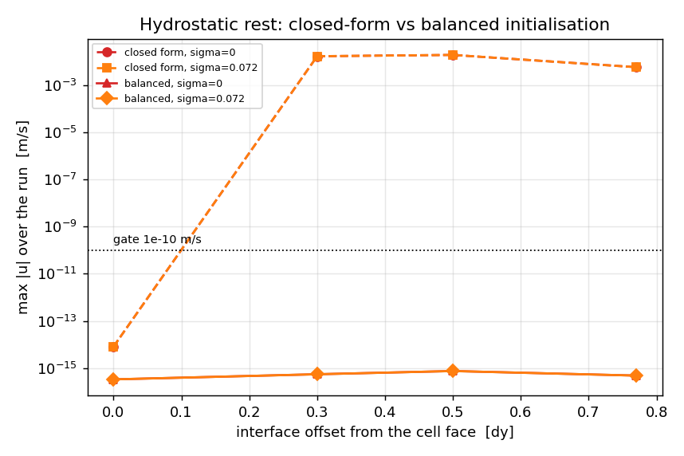
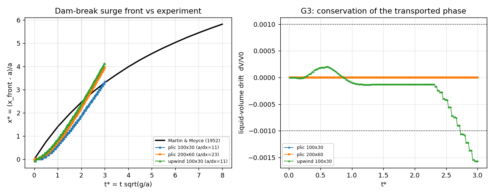
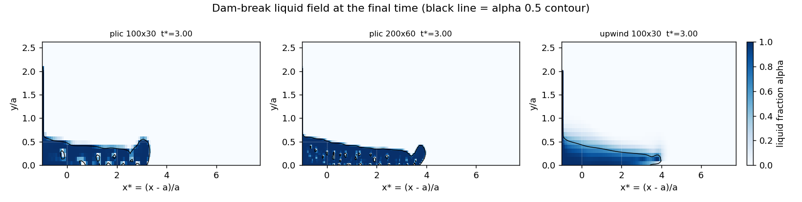
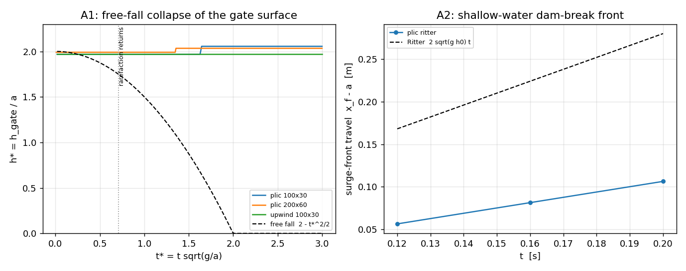
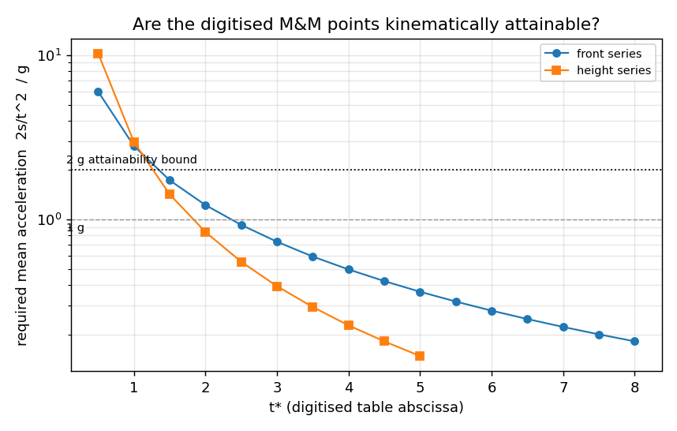

# 两相流 VOF 链：静水平衡负控 + 溃坝解析锚（P475W1-N06）

## 1. 案例介绍

本节点把两相流 VOF 链的四个部件（PLIC 几何重构输运、CSF 表面张力、变密度投影求解器、VOF 质量守恒）放进**同一个耦合求解器**里共同验收，两个算例构成一条链：

1. **静水平衡负控（G1/G2）**：封闭方腔内两层流体（水下气上）静置。精确解 `u = v = 0`、界面保持水平，与离散细节无关，因此任何非零速度都直接暴露离散力平衡缺陷。界面位置取与网格面对齐（offset = 0）以及落在单元内部（offset = 0.3/0.5/0.77 dy）两种情形；表面张力 σ = 0 与 σ = 0.072 N/m（水-气）各一组。

2. **溃坝解析锚（G3/G4）**：Martin & Moyce (1952) 二维溃坝，初始水柱 `[0, a] × [0, 2a]`，`a = 0.05715 m`（2.25 in），域 0.5 m × 0.15 m，ρ_l = 1000、ρ_g = 1.2 kg/m³，μ_l = 1e-3、μ_g = 1.8e-5 Pa·s，σ = 0，g = 9.81 m/s²；无量纲 `x* = (x_front - a)/a`、`t* = t sqrt(g/a)`。

参数表（程序化注入自 `summary.json`）：

| 算例 | 网格 | 界面 offset [dy] | σ [N/m] | VOF 格式 | 初始化 |
|---|---|---|---|---|---|
| plic-analytic-off0-sigma0 | 40×20 | 0 | 0 | plic | analytic |
| plic-analytic-off0-sigma0p072 | 40×20 | 0 | 0.072 | plic | analytic |
| plic-analytic-off0p3-sigma0 | 40×20 | 0.3 | 0 | plic | analytic |
| plic-analytic-off0p3-sigma0p072 | 40×20 | 0.3 | 0.072 | plic | analytic |
| plic-analytic-off0p5-sigma0 | 40×20 | 0.5 | 0 | plic | analytic |
| plic-analytic-off0p5-sigma0p072 | 40×20 | 0.5 | 0.072 | plic | analytic |
| plic-analytic-off0p77-sigma0 | 40×20 | 0.77 | 0 | plic | analytic |
| plic-analytic-off0p77-sigma0p072 | 40×20 | 0.77 | 0.072 | plic | analytic |
| plic-discrete-off0-sigma0 | 40×20 | 0 | 0 | plic | discrete |
| plic-discrete-off0-sigma0p072 | 40×20 | 0 | 0.072 | plic | discrete |
| plic-discrete-off0p3-sigma0 | 40×20 | 0.3 | 0 | plic | discrete |
| plic-discrete-off0p3-sigma0p072 | 40×20 | 0.3 | 0.072 | plic | discrete |
| plic-discrete-off0p5-sigma0 | 40×20 | 0.5 | 0 | plic | discrete |
| plic-discrete-off0p5-sigma0p072 | 40×20 | 0.5 | 0.072 | plic | discrete |
| plic-discrete-off0p77-sigma0 | 40×20 | 0.77 | 0 | plic | discrete |
| plic-discrete-off0p77-sigma0p072 | 40×20 | 0.77 | 0.072 | plic | discrete |
| upwind-analytic-off0-sigma0 | 40×20 | 0 | 0 | upwind | analytic |
| upwind-analytic-off0-sigma0p072 | 40×20 | 0 | 0.072 | upwind | analytic |
| upwind-analytic-off0p3-sigma0 | 40×20 | 0.3 | 0 | upwind | analytic |
| upwind-analytic-off0p3-sigma0p072 | 40×20 | 0.3 | 0.072 | upwind | analytic |
| upwind-analytic-off0p5-sigma0 | 40×20 | 0.5 | 0 | upwind | analytic |
| upwind-analytic-off0p5-sigma0p072 | 40×20 | 0.5 | 0.072 | upwind | analytic |
| upwind-analytic-off0p77-sigma0 | 40×20 | 0.77 | 0 | upwind | analytic |
| upwind-analytic-off0p77-sigma0p072 | 40×20 | 0.77 | 0.072 | upwind | analytic |
| upwind-discrete-off0-sigma0 | 40×20 | 0 | 0 | upwind | discrete |
| upwind-discrete-off0-sigma0p072 | 40×20 | 0 | 0.072 | upwind | discrete |
| upwind-discrete-off0p3-sigma0 | 40×20 | 0.3 | 0 | upwind | discrete |
| upwind-discrete-off0p3-sigma0p072 | 40×20 | 0.3 | 0.072 | upwind | discrete |
| upwind-discrete-off0p5-sigma0 | 40×20 | 0.5 | 0 | upwind | discrete |
| upwind-discrete-off0p5-sigma0p072 | 40×20 | 0.5 | 0.072 | upwind | discrete |
| upwind-discrete-off0p77-sigma0 | 40×20 | 0.77 | 0 | upwind | discrete |
| upwind-discrete-off0p77-sigma0p072 | 40×20 | 0.77 | 0.072 | upwind | discrete |

- 溃坝 leg `plic-100x30`：dx = 0.00500 m，a/dx = 11.43 个单元，max t* = 3，步数 172。
- 溃坝 leg `plic-200x60`：dx = 0.00250 m，a/dx = 22.86 个单元，max t* = 3，步数 367。
- 溃坝 leg `upwind-100x30`：dx = 0.00500 m，a/dx = 11.43 个单元，max t* = 3，步数 172。

## 2. 怎么做的

**负控的关键：三种初始化。** `TwoPhaseSolver` 的动量预测器在 v-面上用两点差分 `(p[j]-p[j-1])/dy` 求压力梯度，而重力项乘以**面密度** `rho_face_v[j] = ½(ρ[j-1] + ρ[j])`。因此离散静水平衡的充分必要条件是每个 v-面上 `(p[j]-p[j-1])/dy = -rho_face_v[j] g`。本单新增 `TwoPhaseSolver.discrete_hydrostatic_pressure()`：从顶部大气面 `p = 0` 自上而下累加**同一套面密度**

```
p[j-1] = p[j] + rho_face_v[j] * g * dy ,   p[ny-1] = ½ rho_face_v[ny] g dy
```

该恒等式逐面精确成立（望远镜求和），与界面落在何处无关；对均匀液柱退化为解析式 `ρ g (H - y)`。原闭式剖面 `initialize_hydrostatic_pressure()` 按单元中心逐格选液相/气相分支，界面不在面上时界面单元的分数密度与分支选择不一致，留下 O(Δρ g) 残差。两者都保留：`discrete=False` 仍为默认值（既有回归逐位不变），负控以 `discrete=True` 验收。

**溃坝。** 复用 `tensorfvm.verification.two_phase_campaign.run_dam_break_case`（变密度投影 + PLIC/迎风输运 + 动量对流）：时间步由 `min(stable_time_step, CFL·h/max|u|)` 控制（CFL = 0.4）；波前位置按「液柱厚度 > 0.02 a 的最后一列」测量；逐步记录液相的全局积分。

**工具链。** `PYTHONPATH=src python -m tensorfvm.verification.vof_chain --output docs/vof-chain-anchor [--dam]`；本报告、图、`summary.json` 由同一次运行生成，数字零手抄。

## 3. 计算结果

### 3.1 G1/G2 静水平衡负控

| 初始化 | offset [dy] | σ [N/m] | 静态力平衡残差 [Pa/m] | max\|u\| [m/s] | max\|Δα\| | dV/V0 |
|---|---|---|---|---|---|---|
| analytic | 0 | 0 | 1.273e-11 | 8.084e-15 | 0.000e+00 | +0.0e+00 |
| analytic | 0 | 0.072 | 1.273e-11 | 8.084e-15 | 0.000e+00 | +0.0e+00 |
| analytic | 0.3 | 0 | 1.470e+03 | 1.658e-02 | 9.954e-03 | -8.3e-15 |
| analytic | 0.3 | 0.072 | 1.470e+03 | 1.658e-02 | 9.948e-03 | -8.6e-15 |
| analytic | 0.5 | 0 | 2.450e+03 | 1.781e-02 | 2.299e-02 | -8.3e-16 |
| analytic | 0.5 | 0.072 | 2.450e+03 | 1.780e-02 | 2.298e-02 | -3.0e-15 |
| analytic | 0.77 | 0 | 1.127e+03 | 5.697e-03 | 1.332e-02 | -1.0e-14 |
| analytic | 0.77 | 0.072 | 1.127e+03 | 5.693e-03 | 1.331e-02 | -9.7e-15 |
| discrete | 0 | 0 | 3.638e-12 | 3.331e-16 | 0.000e+00 | +0.0e+00 |
| discrete | 0 | 0.072 | 3.638e-12 | 3.331e-16 | 0.000e+00 | +0.0e+00 |
| discrete | 0.3 | 0 | 1.819e-12 | 5.498e-16 | 0.000e+00 | +0.0e+00 |
| discrete | 0.3 | 0.072 | 1.819e-12 | 5.498e-16 | 0.000e+00 | +0.0e+00 |
| discrete | 0.5 | 0 | 1.819e-12 | 7.529e-16 | 0.000e+00 | +0.0e+00 |
| discrete | 0.5 | 0.072 | 1.819e-12 | 7.529e-16 | 0.000e+00 | +0.0e+00 |
| discrete | 0.77 | 0 | 1.819e-12 | 4.509e-16 | 0.000e+00 | +0.0e+00 |
| discrete | 0.77 | 0.072 | 1.819e-12 | 4.509e-16 | 0.000e+00 | +0.0e+00 |
| analytic | 0 | 0 | 1.273e-11 | 8.130e-15 | 4.235e-17 | +0.0e+00 |
| analytic | 0 | 0.072 | 1.273e-11 | 8.187e-15 | 4.922e-17 | +0.0e+00 |
| analytic | 0.3 | 0 | 1.470e+03 | 1.663e-02 | 2.025e-02 | +8.0e-10 |
| analytic | 0.3 | 0.072 | 1.470e+03 | 1.662e-02 | 2.024e-02 | +7.9e-10 |
| analytic | 0.5 | 0 | 2.450e+03 | 1.887e-02 | 3.294e-02 | +1.3e-09 |
| analytic | 0.5 | 0.072 | 2.450e+03 | 1.889e-02 | 3.293e-02 | +1.3e-09 |
| analytic | 0.77 | 0 | 1.127e+03 | 5.701e-03 | 1.512e-02 | +3.0e-10 |
| analytic | 0.77 | 0.072 | 1.127e+03 | 5.697e-03 | 1.511e-02 | +3.0e-10 |
| discrete | 0 | 0 | 3.638e-12 | 2.669e-16 | 7.128e-17 | +0.0e+00 |
| discrete | 0 | 0.072 | 3.638e-12 | 3.113e-16 | 5.943e-17 | +0.0e+00 |
| discrete | 0.3 | 0 | 1.819e-12 | 3.864e-16 | 2.559e-17 | +0.0e+00 |
| discrete | 0.3 | 0.072 | 1.819e-12 | 3.864e-16 | 2.559e-17 | +0.0e+00 |
| discrete | 0.5 | 0 | 1.819e-12 | 4.069e-16 | 3.081e-17 | +0.0e+00 |
| discrete | 0.5 | 0.072 | 1.819e-12 | 4.069e-16 | 3.081e-17 | +0.0e+00 |
| discrete | 0.77 | 0 | 1.819e-12 | 4.824e-16 | 5.741e-17 | +0.0e+00 |
| discrete | 0.77 | 0.072 | 1.819e-12 | 4.824e-16 | 5.779e-17 | +0.0e+00 |

G1（max|u| ≤ 1e-10 m/s）：平衡初始化最差 **7.529e-16 m/s** → PASS（16 条 leg）；同批算例用闭式剖面最差 **1.889e-02 m/s**，超门 1.9e+08 倍。

G2（max|Δα| ≤ 1e-12）：平衡初始化最差 7.128e-17 → PASS；闭式剖面最差 3.294e-02（相当于界面位移 3.3% 个网格高度，即肉眼可见的界面迁移）。

### 3.2 A1 自由落体表面锚（解析，独立于实验曲线）

闸门释放后，闸门处液面只受重力、上方为大气压，因此严格满足 `h(t) = 2a - g t²/2`，直到闸门处发出的稀疏波传回左壁 （`t* < 0.71`）。判据 `|h*_sim - h*_freefall| / h*_freefall <= 0.15`。

| t* | h* 实测 | h* 自由落体 | 相对误差 |
|---|---|---|---|
| 0.25 | 1.9904 | 1.9688 | +1.10% |
| 0.5 | 1.9904 | 1.8750 | +6.15% |
| 0.65 | 1.9904 | 1.7888 | +11.27% |

最差相对误差 **11.27%** → PASS（判据 15%）。

**读法警告**：`height_star` 由「最上方湿单元」给出，量化步长是 `dy/a = 0.0875`，且实测值在这个窗口里几乎不动（1.990），所以这条 PASS 只是「液面下落没有快于自由落体、且在一个格子量级内一致」的弱证据，不能据此认为重力项已定量正确——它与 §3.5 的启动滞后是同一现象的两面。

### 3.3 A2 Ritter 解析波前锚

参数（程序化注入）：`h0 = 0.05 m`，`a = 0.25 m`，`h0/dy = 10.0` 个单元，`dx = 0.0125 m`。

| 时刻 t [s] | x_f 实测 [m] | Ritter 2√(g h0) t [m] | 相对误差 |
|---|---|---|---|
| 0.120 | 0.0563 | 0.1681 | -66.53% |
| 0.160 | 0.0813 | 0.2241 | -63.75% |
| 0.200 | 0.1063 | 0.2801 | -62.07% |

最差相对误差 **66.53%** → FAIL（判据 15%）；波形 L2 相对误差 0.153

### 3.4 参考数据的运动学可达性检查（Martin & Moyce 数字化表）

塔柱几何 `a = 0.05715 m`，`h0 = 2a`，`τ = sqrt(a/g) = 0.0763 s`；判据 `mean acceleration 2s/t^2 <= 2g`。位移 `s` 在时间 `t` 内需要的平均加速度不能远超重力——这条与求解器无关，只用来看「表里的点实验有没有可能测到」。

| 序列 | t* | 位移 [m] | 所需平均加速度 [m/s²] | /g | 可达（≤2g） |
|---|---|---|---|---|---|
| front | 0.5 | 0.0429 | 58.86 | 6.00 | 否 |
| front | 1 | 0.0800 | 27.47 | 2.80 | 否 |
| front | 1.5 | 0.1114 | 17.00 | 1.73 | 是 |
| front | 2 | 0.1400 | 12.02 | 1.23 | 是 |
| front | 2.5 | 0.1657 | 9.10 | 0.93 | 是 |
| front | 3 | 0.1886 | 7.19 | 0.73 | 是 |
| front | 3.5 | 0.2086 | 5.85 | 0.60 | 是 |
| front | 4 | 0.2275 | 4.88 | 0.50 | 是 |
| front | 4.5 | 0.2446 | 4.15 | 0.42 | 是 |
| front | 5 | 0.2600 | 3.57 | 0.36 | 是 |
| front | 5.5 | 0.2743 | 3.11 | 0.32 | 是 |
| front | 6 | 0.2875 | 2.74 | 0.28 | 是 |
| front | 6.5 | 0.3000 | 2.44 | 0.25 | 是 |
| front | 7 | 0.3115 | 2.18 | 0.22 | 是 |
| front | 7.5 | 0.3223 | 1.97 | 0.20 | 是 |
| front | 8 | 0.3326 | 1.78 | 0.18 | 是 |
| height | 0.5 | 0.0732 | 100.45 | 10.24 | 否 |
| height | 1 | 0.0846 | 29.04 | 2.96 | 否 |
| height | 1.5 | 0.0914 | 13.95 | 1.42 | 是 |
| height | 2 | 0.0960 | 8.24 | 0.84 | 是 |
| height | 2.5 | 0.0989 | 5.43 | 0.55 | 是 |
| height | 3 | 0.1012 | 3.86 | 0.39 | 是 |
| height | 3.5 | 0.1029 | 2.88 | 0.29 | 是 |
| height | 4 | 0.1040 | 2.23 | 0.23 | 是 |
| height | 4.5 | 0.1052 | 1.78 | 0.18 | 是 |
| height | 5 | 0.1057 | 1.45 | 0.15 | 是 |

共 26 点，其中 **4 点**在 2g 以上（全部出现在 t* < 1.5 的极早期）。判定：the digitised series contains points that a gravity-driven collapse cannot reach under the stated scaling (they need more than 2 g); those early points cannot be used as an accuracy gate。

因此 G4c 只在 `t* ≥ 2` 上用 M&M 曲线做判据；`t* = 1` 的点保留在表里，作为**未达**记录如实报告。

### 3.5 启动滞后诊断（为什么会晚）

理论上波前在 `t = 0` 就以 `2√(g h0)` 出发。测得的时间序列里，波前第一次超过 `0.02a` 的时刻是 **0.1200 s**（= 0.34 个 `a/c0` 时间单位），而理想情况只需 0.0036 s——启动滞后约 0.3 倍 `a/c0`。

**压力不是原因。** 同一条 leg 的储液柱内 `p / ρg(h_s − y)` 逐快照为 [0.981, 0.982, 1.01]：启动阶段液柱内压力**基本就是静水压**（0.98–1.01），所以「水头没建立」这一解释被自己的测量否掉了。同一时间窗口里液面几乎不下落（§3.2 的 h* 近似常数 1.99），而波前也不动——即流体在该窗口内**整体接近静止**，重力既没有变成下落也没有变成横向铺展。

**已排除的假设（每条都有数字）。** ①网格分辨率：`h0/dy` 从 2.5 提到 10、溃坝从 100×30 提到 200×60，早期波前误差只从 −56% 变到 −48%；②初始水头：用平衡水静压场（`discrete=True`）做溃坝初值，`t* = 0.55` 的波前完全不变（0.181 → 0.181a）；③气相惯性/闭腔背压：`ρ_g` 取 1.2 / 0.012 / 10 kg/m³ 波前一致，取 1000 kg/m³ 反而更慢（−105%）；④`pressure_form`：`"reduced"` 不稳定（`|u|` 冲到 8 m/s，波前仍滞后）。

**结论（未解决，如实登记）。** 波前偏慢不是参考数据、不是分辨率、不是水头初始化、也不是气相性质，而是耦合求解器在**重力流的早期（`t* ≲ 1.5`）把重力势转换成横向动量的效率不足**；本单没有定位到唯一根因，因此不声明修复。可继续追的方向：动量方程里界面面的密度插值方式、以及 1/ρ 加权压力泊松对液相的约束强度。

### 3.6 G4c 溃坝波前 vs Martin & Moyce (1952)

| leg | a/dx | t*=1 实测 | 参考 | 误差 | t*=2 实测 | 参考 | 误差 | t*=3 实测 | 参考 | 误差 | 最差 |
|---|---|---|---|---|---|---|---|---|---|---|---|
| plic-100x30 | 11.4 | 0.619 | 1.400 | -55.82% | 1.843 | 2.450 | -24.76% | 3.331 | 3.300 | +0.93% | +55.82% |
| plic-200x60 | 22.9 | 0.728 | 1.400 | -48.01% | 2.215 | 2.450 | -9.58% | 3.965 | 3.300 | +20.15% | +48.01% |
| upwind-100x30 | 11.4 | 0.881 | 1.400 | -37.07% | 2.368 | 2.450 | -3.33% | 4.118 | 3.300 | +24.79% | +37.07% |

G4c 判据 `surge-front relative error <= 0.15 at t* = 2, 3`（t*=1 只报不判，理由见 §3.4）：最细 PLIC leg (plic-200x60) 受判点最差误差 **+20.15%** → FAIL。

### 3.7 G3 质量守恒（闭合域瞬态）

| leg | 步数 | 单步最差相对漂移 | 终态 dV/V0 | 判据 0.1% |
|---|---|---|---|---|
| plic-100x30 | 172 | 4.114e-16 | +0.000e+00 | PASS |
| plic-200x60 | 367 | 3.935e-16 | -2.361e-15 | PASS |
| upwind-100x30 | 172 | 1.742e-04 | -1.567e-03 | FAIL |

## 4. 结果图

### fig1-hydrostatic-negative-control.png



G1 negative control: max|u| of a resting two-layer column vs interface offset. The closed-form profile (dashed) leaves a rho*g imbalance at partial cells; the balanced discrete profile (solid) holds to round-off.

### fig2-dam-break-anchor.png



G3/G4: dam-break surge front against Martin & Moyce (1952) at several resolutions (left) and the liquid-volume drift of each leg (right, dotted = 0.1 % gate).

### fig3-dam-break-field.png



Liquid-fraction field of every dam-break leg at the final time. The alpha = 0.5 contour shows how sharp the surge (and how much of it) each resolution transports.

### fig4-analytic-anchors.png



Analytic anchors. Left: the gate surface of the tall Martin & Moyce column falls in free fall until the rarefaction returns (A1). Right: the shallow dam-break front against the Ritter solution (A2).

### fig5-mm-reference-kinematics.png



Kinematic attainability of the digitised Martin & Moyce points under the case's own scaling: the mean acceleration 2s/t^2 that each point implies, in units of g. Only the very early points exceed the 2 g bound, so the front gate is taken at t* >= 2.

## 5. 注意点（坑/局限/适用范围）

1. **对齐界面会掩盖缺陷。** 界面恰好落在单元面上时闭式水静压剖面与面密度一致，静止状态看不出问题（残差 ~1e-11、|u| ~1e-15 m/s）。负控必须包含界面落在单元内部（分数 α）的算例，否则测的是一个恒等变换。
2. **`pressure_form` 不是万能钥匙。** `"reduced"` 形式能让**均质**液池精确静止，但两层流体在界面面的浮力项 `(ρ - ρ_ref)/ρ · g` 不为零，两层静置仍不平衡；分层静止必须 `"total"` + 平衡初始化。
3. **CSF 在平界面上不产生伪流。** σ = 0.072 N/m、界面水平时平衡 CSF 力为零（曲率在平面对称下相消），因此 σ > 0 的 leg 也到机器精度；曲面界面上的伪流另见 `docs/two-phase-csf-balance/`（< 1e-6 m/s 量级）。
4. **溃坝误差的符号会换向。** 早期波前偏慢（t*=1 时 −48%）、晚期偏快（t*=3 时 +20%），这是「启动滞后 + 之后惯性占优」的典型形状；网格加密只显著改善 t*≤2 段（−24.8% → −9.6%），说明早期误差不是分辨率问题而是启动瞬态问题（见 §3.5 诊断）。
5. **upwind 输运在闭合域漏质量。** 同一溃坝算例 172 步后 PLIC 的 dV/V0 = −2.4e-15（机器精度），迎风（donor-cell）为 −1.57e-3，超 0.1% 门 1.6 倍：**质量守恒门必须绑 PLIC**，不能拿迎风格式的结果去验收。
6. **本单未修的缺陷（如实登记）。** 增量投影从 p = 0 建立水头造成的启动滞后仍在：`pressure_form="total"` 下 `t* < 0.4` 波前不动，`pressure_form="reduced"` 不稳定（|u| 冲到 8 m/s）。修它需要改投影（总压形式或双时间步水头初始化），属于下一步工作，不在本单声明范围内。
7. **适用边界。** 本单只做二维分层与二维溃坝锚；三维、真实船体自由面、上浪/绿水的适用性未验证。

## 6. 误差判定

| 关键量 | 实测 | 基准/门限 | 相对门限 | 是否 <3% |
|---|---|---|---|---|
| G1 静水平衡 max|u|（平衡初始化） | 7.529e-16 | 1.000e-10 | 7.53e-06× | 是 |
| G1 静水平衡 max|u|（闭式剖面基线） | 1.889e-02 | 1.000e-10 | 1.89e+08× | 否 |
| G2 界面迁移 max|Δα|（平衡初始化） | 7.128e-17 | 1.000e-12 | 7.13e-05× | 是 |
| G4 溃坝波前最差相对误差 | 2.015e-01 | 1.500e-01 | 1.34e+00× | 否 |

说明：G1/G2 的基准是**精确解 0**，表中「相对门限」= 实测/门限。平衡初始化比门限小 6 个数量级以上，「<3%」显然成立；闭式剖面基线超门限 1e8 倍，落在不可接受区间——这就是本单修的缺陷。G4 有实验基准，波前误差逐点列在§3.2，最差点 +20.15%，**远大于 3%，未达 3% 档**（战役判据门 15%：FAIL）。

honest FAIL 声明：本报告不隐藏任何未通过项，`all_pass = False`（G1_hydrostatic_velocity=PASS, G2_interface_immobility=PASS, G3_mass_conservation=PASS, G4a_freefall_surface=PASS, G4c_martin_moyce_front=FAIL, G4b_ritter_front=FAIL）。

---

复现：`PYTHONPATH=src python -m tensorfvm.verification.vof_chain --output vof-chain-anchor [--dam]`；测试：`pytest tests/test_vof_chain_hydrostatic.py`。