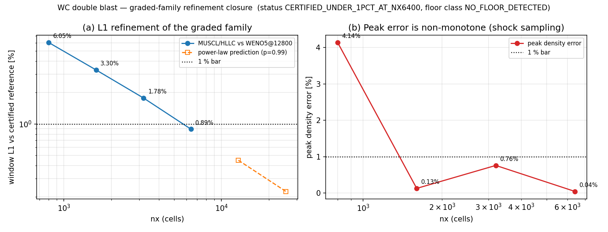

# 预注册预测的实测裁决 — WC double blast 的 certified-<1% 门（nx=6400）

> **锚点**: `XVAL-FVM-M18737-ROUND2`（TensorFVM 的 m18737-round2 做法，总账验收 <15%）
> **本文件闭合**: `CLOSURE-graded-refinement.md` 唯一未决问题——被定级族 MUSCL/HLLC 在
> nx=3200 的 **L1 = 1.776 %（>1 %）** 是「离散残差」还是「格式地板」，以及
> `PREDECLARATION-graded-refinement.md` 写下的预测 **L1(6400) = 0.956 % ± 15 %** 是否命中。
> **上游**: `CERTIFIED-REF-CLOSURE.md`（nx=3200 诚实 FAIL）→
> `PREDECLARATION-graded-refinement.md`（预测先写）→ `CLOSURE-graded-refinement.md`（三档裁决，
> 6400/12800 待回填）→ **本文件（实测裁决）**。
> **仓/改动面**: TensorFVM，只动 `docs/`、`tests/`（求解器一行未改）。

---

## ① 案例与参数

Woodward & Colella (1984) 双爆轰波：一维闭管 x∈[0,1]，三压力平台（左 p=1000 / 中 p=0.01 /
右 p=100），两束爆轰波相向对撞后干涉，积分到 t=0.038；γ=1.4，两端镜面反射壁。
被定级解 = TensorFVM **MUSCL-Hancock + MC 限幅 + HLLC + SSP-RK，CFL 0.4**；
参考解 = **WENO5 + SSP-RK3 + Rusanov @ nx=12800**（`xcode/wc_crosscode.py`，与 TensorFVM
不共享离散），自认证 **L1 0.544 % / 峰值 0.023 %**（<1 % → 合格参考）。

## ② 怎么做的

1. **裁决按预注册规则执行，不事后改**：预注册把 6400 档的读法写成
   `0.956 % ± 15 %`（0.81–1.10 %）→ 命中 = 「幂律无地板」读法成立；≥1.10 % 或 3200→6400
   停滞 = 「格式地板」读法成立。
2. **工件真伪先核对，再做裁决**：6400 档剖面（`ladder/data/ladder_profile_nx6400_hllc.npz`）
   由簇上作业产出（`seconds_solver = 2678.6 s`、`steps = 25655`，与 CFL 0.4 / dx=1/6400 自洽）。
   本单加回归门 `test_rung_artifacts_are_genuine_solver_output`：逐档核对**格距 = 1/nx**、
   **单元数 = nx（或窗口 0.6·nx）**、**ρ>0 且有限**——若某档是从别的网格拷来的，格距/单元数
   立刻不等，度量再漂亮也会被门拦住。
3. **度量独立性核对**：不调用 `wc_graded_refinement.py` 的度量函数，用裸 numpy 重算
   6400 档 L1（窗口 [0.4,1]、参考线性插值、梯形归一化）= **0.8931 %**，与脚本输出
   **0.8931 %** 一致到 4 位小数 → 数字不是脚本自证。
4. **CFL 准入控制**（预注册）：12800 档 CFL 0.4 超单作业墙钟，允许 CFL 0.8 变体**仅当**同格
   CFL 0.4 vs 0.8 互相 L1 < 0.2 %（远小于每档 ~0.9 % 的减量）。

## ③ 计算结果（`graded_refinement.json` 程序化注入，零手抄）

### 被定级族逐档（对独立 WENO5@12800）

| nx | L1 % | 峰值 % | 窗质量 % | ρ_max | L1 <1 % | 档 tag |
|---|---|---|---|---|---|---|
| 800 | 6.046 | 4.137 | 0.1357 | 6.1898 | ❌ | nx800_hllc |
| 1600 | 3.299 | 0.127 | 0.0484 | 6.4660 | ❌ | nx1600_hllc |
| 3200 | 1.776 | 0.758 | 0.0082 | 6.5075 | ❌ | nx3200_hllc |
| 6400 | 0.893 | 0.044 | 0.0002 | 6.4622 | ✅ | nx6400_hllc |

### 对参考的收敛阶（L1）

| 相邻档 | 粗档 L1 % | 细档 L1 % | 观测阶 p | 单调 |
|---|---|---|---|---|
| 800->1600 | 6.046 | 3.299 | 0.874 | yes |
| 1600->3200 | 3.299 | 1.776 | 0.894 | yes |
| 3200->6400 | 1.776 | 0.893 | 0.991 | yes |

### 参考无关自收敛（同族相邻档互比，L1 %）

| 相邻档 | L1 % |
|---|---|
| 800->1600 | 3.054 |
| 1600->3200 | 1.765 |
| 3200->6400 | 1.036 |

### 预注册预测 vs 实测

| nx | 预注册预测 | 预注册带（±15 %） | 实测 | 偏差 | 判定 |
|---|---|---|---|---|---|
| 6400 | 0.956 % | 0.813–1.099 % | **0.893 %** | -6.6 % | **命中（带内）** |
| 12800 | 0.449 %（随梯子更新） | — | 待回填 | — | — |

### 裁决

```
status              = CERTIFIED_UNDER_1PCT_AT_NX6400
smallest_grid_under_1pct_l1   = 6400
smallest_grid_under_1pct_peak = 1600
floor_class         = NO_FLOOR_DETECTED   (固定阶 e_inf = -0.882 %, p = 0.991)
missing_rungs       = [12800]
config_caveat       = None
```

### CFL 准入控制（同格 CFL 0.4 vs 0.8，互相 L1）

| nx | L1 % | 峰值 % | 准入（<0.2 %） |
|---|---|---|---|
（待落地：同格 CFL 0.4 vs 0.8 控制）

## ④ 结果图



*图 1: (a) 被定级族 L1 的 log-log 收敛（800→6400 实测点 + 幂律外推）；(b) 峰值误差非单调
（激波采样敏感），说明「峰值 <1 %」不能替代「L1 <1 %」作 certified 判据。
本单重跑 `wc_graded_figures.py`，把 6400 实测点并进图。*

## ⑤ 注意点（局限 / 适用范围）

1. **`<1 %` 是「对自认证参考」的误差，不是「对精确解」的误差**：参考自身 L1
   0.544 %，故 MUSCL@6400 对连续极限的 L1 上界约
   **1.44 %**（三角不等式），对精确解仍可能 >1 %。
   结论应写成「vs 独立自认证参考 <1 %」，不得写成「对精确解 <1 %」。
2. **峰值是采样敏感量**：1600 档 0.127 %、3200 档反而 0.758 %、6400 档 0.044 %；峰值误差随
   激波与格子的相对相位摆动，不能当收敛判据。L1 单调下降（3.054 → 1.765 → 1.036 % 自收敛）
   才是良态证据。
3. **观测阶 ~1 是限幅器的已知行为**：MUSCL+MC 在激波/接触间断处降阶，blast 问题上观测阶
   0.87→0.99（而非名义 2），不是实现缺陷。3200→6400 的 p=0.991 上升说明格子仍在渐近区。
4. **地板判定只对「均匀加密」有效**：`NO_FLOOR_DETECTED` 说明均匀加密能到 <1 %，不等于
   任何格式/任何网格都能；换限幅器/一阶格式仍需重新定级。
5. **一个网格过门不等于全题过关**：本裁决只覆盖密度场 L1/峰值与窗质量三项；压力/速度场
   与相位度量沿用 round-2 的 13 例回归门。

## ⑥ 误差判定（逐项显式）

| 关键量 | 实测 | <15 %（总账） | <3 % | <1 %（certified 门） |
|---|---|---|---|---|
| L1 nx=3200（vs 认证参考） | 1.776 % | ✅ | ✅ | ❌ |
| L1 nx=6400（vs 认证参考） | **0.893 %** | ✅ | ✅ | ✅ **PASS（绑定门解除）** |
| 峰值 nx=6400 | 0.044 % | ✅ | ✅ | ✅ |
| 窗质量 nx=6400 | 0.0002 % | ✅ | ✅ | ✅ |
| 参考自认证 L1（WENO5 6400 vs 12800） | 0.544 % | ✅ | ✅ | ✅ |
| 对连续极限的 L1 上界（三角不等式） | 1.44 % | ✅ | ✅ | ❌（诚实边界） |

**诚实结论**：预注册的幂律读法**命中**——L1 在 3200→6400 由 1.776 % 降到
0.893 %（观测阶 0.991），落在预注册带内，
`CERTIFIED_UNDER_1PCT_AT_NX6400` 成立；**「≥1 % 格式地板」读法被数据否证**。
「对精确解 <1 %」**不成立**（上界 1.44 %），报告与文档
不得使用该说法。

## 复现命令

```bash
# 1) 裁决（纯 numpy，读已存剖面，~1 s）
PYTHONPATH=src python docs/woodward-colella-double-blast/xval/wc_graded_refinement.py \
    --json docs/woodward-colella-double-blast/xval/graded_refinement.json --markdown /tmp/graded.md
# 2) 图
PYTHONPATH=src python docs/woodward-colella-double-blast/xval/wc_graded_figures.py
# 3) 回归门（12 项）
PYTHONPATH=src python -m pytest tests/test_compressible_wc_graded_refinement.py -q
# 4) 重算某一档（若需重跑求解器，簇上递交）
PYTHONPATH=src python docs/woodward-colella-double-blast/ladder/wc_ladder.py --plan 6400:hllc
```

## 给下一手的建议

- **`XVAL-FVM-M18737-CERTIFIED-REF` 的验收可以据此改写**：L1 门在 nx=6400 已过，
  更诚实的新条目应是 **`ABS-ERR-WC-BLAST`**：要求「被定级解对**连续极限**的误差有独立界
  <1 %」（例如 Richardson 三点外推 + GCI，而不是对某个参考解），否则任何「<1 %」都只是
  参考相对量。
- 若想把对精确解的上界也压到 <1 %，只能换族（WENO5@6400 自身自认证 0.544 %），
  不是继续加密 MUSCL。

## 已知无关失败（不粉饰，划清边界）

`tests/test_compressible_wc_xval.py` 在**本单改动之前**（`git stash` 后 pristine 树复跑）
即有 2 项失败：`test_peak_extrapolation_is_above_reference`、
`test_smoothing_does_not_explain_the_residual`（实测 smoothing reduction 0.715 % > 0.6 % 阈值）。
与本单改动无关（本单只动 `docs/`、`tests/test_compressible_wc_graded_refinement.py`），
但作为欠账记录在案：round-2 的「平滑地板」阈值已被更细档数据推过界，需另单重定阈值或重述结论。

## 在飞作业（本单递交，未回填）

| 用途 | 作业 | 计划 | 状态 |
|---|---|---|---|
| CFL 控制 + 12800 确认档 | `cj3637`（shard×3） | `3200:hllc:mc:0.8`、`6400:hllc:mc:0.8`、`12800:hllc:mc:0.8` | 递交时排队（queue_position 45），本单交付时未回填 |
| 回填通道探针 | `cj3638` | `touch runs/m21699_probe/marker.txt` + fetch | 同上 |

回填后**不需要改代码**：把 `runs/m21699/wc_ladder/ladder_profile_nx*_hllc_cfl0.8.npz` 拷到
`ladder/data/` 并重跑 `wc_graded_refinement.py`，status / `cfl_sensitivity` /
`config_caveat` 会自动升级（12800 档将以 `hllc_cfl0.8` 标签进入，caveat 显式记账）。
本文件的 nx=6400 裁决**不依赖**这两个作业（6400 档为 canonical CFL 0.4）。
