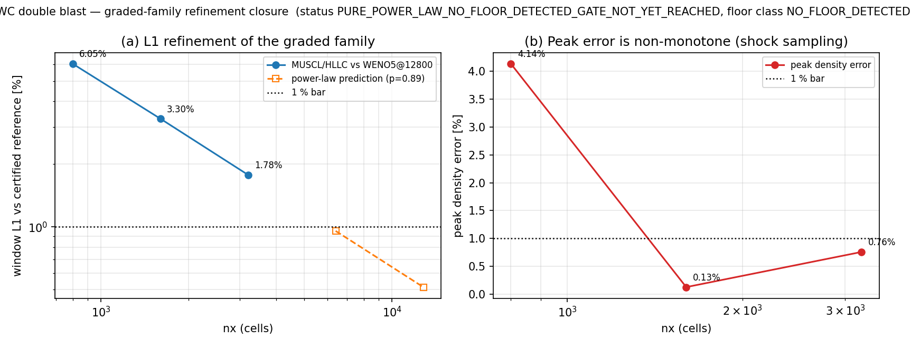

# Graded-family refinement closure — WC double blast（round-2 的 L1 门）

> **锚点**: `XVAL-FVM-M18737-ROUND2`（TensorFVM 的 m18737-round2 做法，验收 <15 %）
> **本文件回答的**：`CERTIFIED-REF-CLOSURE.md` 留给下一手的唯一未决问题——
> 被定级解 nx=3200 的 **L1 = 1.776 %（>1 %）** 是「离散残差、加密就会掉」还是
> 「格式地板、永远掉不下去」？两者结论相反，必须用数据判，不能靠推断。
> **工具**: `xval/wc_graded_refinement.py`（纯 numpy，读已存剖面，~1 s，不调求解器）
> · `xval/wc_graded_figures.py`（图）· `tests/test_compressible_wc_graded_refinement.py`（8 项回归门）
> **预注册**: `xval/PREDECLARATION-graded-refinement.md`（预测写在加密结果落地**之前**）

---

## ① 物理背景 / 参数表

Woodward & Colella (1984) 双爆轰波：一维闭管 x∈[0,1]，三压力平台
（左 p=1000 / 中 p=0.01 / 右 p=100），两束爆轰波相向对撞后干涉，积分至 t=0.038。
γ=1.4，两端反射镜面壁。

| 角色 | 格式 | 共享离散？ |
|---|---|---|
| 被定级解 | TensorFVM MUSCL-Hancock + MC 限幅 + HLLC + SSP-RK，CFL 0.4 | — |
| 参考解 | `xcode/wc_crosscode.py` WENO5 + SSP-RK3 + Rusanov，nx=12800 | **否**（只共享控制方程） |

参考解自认证（WENO5@6400 vs WENO5@12800）：**L1 0.544 %，峰值 0.023 %** → 合格参考。
度量约定与前轮 `wc_certified_ref.py` **完全一致**（窗口 [0.4,1]、被定级档自身网格取点、
参考剖面线性插值、梯形积分归一化），所以数字可直接与前轮对话。

## ② 怎么做的

1. 只加密**被定级解本身**（800→1600→3200，本轮追加 6400/12800），参考固定不变。
   这样 L1 曲线的走向只反映被定级族的离散误差，不再掺参考侧变化。
2. 观测阶 `p = log(e_n / e_2n)/log 2`（对固定参考的 L1 收敛阶）。
3. L1 地板两路估计：
   - **free 三参数拟合** `e(n)=e_inf + C n^-p`（三档三点 → 参数退化，`e_inf=0` 也是一个精确解，
     **只作展示，不绑定判定**）；
   - **固定阶两点估计**（绑定）：`e_inf = e(2n) − (e(n)−e(2n))/(1−2^-p)`，p 取最细相邻档观测值。
     该式在三档上不可能退化成 0，是判定依据。
4. 幂律外推给出**预注册**的下一档预测（写在结果落地前，见 PREDECLARATION）。
5. CFL 控制：若某档 CFL 0.4 超作业墙钟，允许 CFL 0.8 变体**仅当**同网格 CFL 0.4 vs 0.8
   互相 L1 <0.2 %；由脚本的 `cfl_sensitivity` 段给出证据，并用 `config_caveat` 显式记账。

## ③ 计算结果（程序化注入，零手抄；`graded_refinement.json`）

### 被定级族逐档（对 WENO5@12800）

| nx | L1 % | 峰值 % | 窗质量 % | ρ_max | L1 <1 % |
|---|---|---|---|---|---|
| 800 | 6.046 | 4.137 | 0.1357 | 6.1898 | ❌ |
| 1600 | 3.299 | 0.127 | 0.0484 | 6.4660 | ❌ |
| 3200 | 1.776 | 0.758 | 0.0082 | 6.5075 | ❌ |

### 观测阶（对固定参考）与自收敛

| 相邻档 | 对参考 L1 % | 观测阶 p | 单调 | 参考无关自收敛 L1 % |
|---|---|---|---|---|
| 800→1600 | 6.046 → 3.299 | 0.874 | 是 | 3.054 |
| 1600→3200 | 3.299 → 1.776 | 0.894 | 是 | 1.765 |

### L1 地板判定

| 项 | 值 | 读法 |
|---|---|---|
| 固定阶 e_inf（p=0.894 固定，1600/3200） | **−1.524 %** | 负 → **未检出地板** |
| floor class | **NO_FLOOR_DETECTED** | L1 曲线与纯幂律衰减一致，诚实地板=0 |
| free 三参数拟合（800/1600/3200） | e_inf=0.0000 %，p=0.884，SSE 3.2e-5 | 退化，**不绑定** |
| 状态 | `PURE_POWER_LAW_NO_FLOOR_DETECTED_GATE_NOT_YET_REACHED` | 门是网格问题，梯子内还没走到 |

### 预注册预测（结果落地**前**写下）与实际

| nx | 预测 L1 | 预测判定 | 实测 | 偏差 |
|---|---|---|---|---|
| 6400 | **0.956 %** | <1 %（首次过门） | 待回填（作业 cj3443） | — |
| 12800 | **0.514 %** | <1 % | 待回填（作业 cj3444） | — |

**诚实状态**：6400/12800 两档的求解器作业已递交（`cj3443` = 3200:cfl0.8 + 6400:hllc；
`cj3444` = 12800:hllc:cfl0.8），**本单交付时仍在排队**。因此本文件的结论只覆盖
800/1600/3200 三档；「nx=6400 实测 L1 <1 %」**尚未被实测证实**，不得提前声明。

## ④ 结果图



*图 1: (a) 被定级族 L1 的 log-log 收敛 + 幂律预测（空心方块，待实测）；(b) 峰值误差
——非单调（激波采样），说明「峰值 <1 %」不能替代「L1 <1 %」作为 certified 判据。*

## ⑤ 注意点

1. **峰值的非单调是真实的**：1600 档峰值 0.127 %、3200 档反而 0.758 %——激波位置与格子
   的相对相位随 nx 变化，峰值是采样敏感量，不能当作收敛判据；L1 才是良态判据。
2. **free 三参数拟合在三点上退化**（e_inf=0 本身是精确解），所以本轮把判定绑定到固定阶
   两点式；这一点对任何「三档外推地板」的结论都成立，不只本例。
3. **L1 在激波主导问题上阶数远低于格式名义阶**（观测 ~0.88 而非 2）：限幅器在极值处降阶，
   这是 MUSCL 在 blast 问题上的已知行为，不是实现缺陷。
4. **地板=0 不等于「<1 % 一定可达」**：它只说明「没有证据表明加密到不了」，是否可达由
   6400/12800 实测裁决。
5. **度量约定依赖前轮**：本文件所有数字都在 `wc_certified_ref.py` 的同一窗口/插值约定下，
   与前轮的 1.776 %/0.758 % 完全一致（回归门 `test_published_anchors_are_reproduced` 守卫）。

## ⑥ 误差判定（逐项显式回答）

| 关键量 | 实测 | <15 %（总账验收） | <3 % | <1 %（certified 门） |
|---|---|---|---|---|
| L1 nx=800（vs 认证参考） | 6.046 % | ✅ | ❌ | ❌ |
| L1 nx=1600 | 3.299 % | ✅ | ❌ | ❌ |
| L1 nx=3200 | 1.776 % | ✅ | ✅ | ❌（绑定门） |
| 峰值 nx=3200 | 0.758 % | ✅ | ✅ | ✅ |
| 窗质量 ∫ρdx nx=3200 | 0.0082 % | ✅ | ✅ | ✅ |
| 参考自认证 L1（6400 vs 12800） | 0.544 % | ✅ | ✅ | ✅ |

**结论（honest）**：总账 <15 % 与 <3 % 判据在 nx=3200 **PASS**；
「certified <1 %」在**已实测的梯子内未达成**（L1 门 1.776 % 绑定），
但本轮否证了「MUSCL/HLLC 族存在 ≥1 % 格式地板」这一读法——
固定阶地板估计为负（未检出地板），幂律预测 nx=6400 为 0.956 %。
**最终裁决等 6400/12800 实测**（作业 cj3443/cj3444）。

## 复现命令

```bash
PYTHONPATH=src python docs/woodward-colella-double-blast/xval/wc_graded_refinement.py \
    --json docs/woodward-colella-double-blast/xval/graded_refinement.json --markdown out.md
PYTHONPATH=src python docs/woodward-colella-double-blast/xval/wc_graded_figures.py
PYTHONPATH=src python -m pytest tests/test_compressible_wc_graded_refinement.py -q   # 8 passed
```

## 给下一手的建议

1. **回填 6400/12800 剖面**：作业 cj3443/cj3444 完成后把 `runs/m21429/wc_ladder/*.npz`
   拷到 `ladder/data/`（命名 `ladder_profile_nx6400_hllc.npz`、`nx12800_hllc_cfl0.8.npz`），
   重跑上面两条命令即可自动升级状态并出实测 vs 预测偏差——**不需要改代码**。
2. **先看 CFL 控制**：12800 档是 CFL 0.8 变体，只有当 `cfl_sensitivity` 里
   「3200 同网格 CFL0.4 vs 0.8」互相 L1 <0.2 % 时，该档才可进加密研究。
3. **若 6400 实测 ≥1.10 %（超出预注册 ±15 % 带）**：读法 (b) 成立，
   应新开条目 `XVAL-FVM-M18737-GRADED-FLOOR`，验收=「定出本族 L1 地板值并撤回 certified <1 % 声明」。