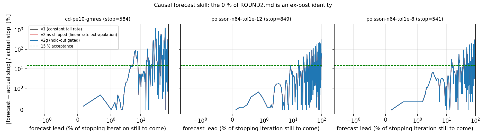

# 因果（前缀）预测审计 — 收敛诊断 round-2

**锚点**：`XVAL-FVM-M18737-ROUND2`（TensorFVM 的 m18737-round2 做法）· verifier 席（tp-ver-6）
**上游工件**：`docs/xval-round2/ROUND2.md`（m20032 交付，声明「6 个衰变算例预测误差 0.00%，benchmark PASS」）
**本单定位**：对已完成工件做对抗式复核（adversarial review），并把可证伪的度量装回门禁。
**仓/改动面**：TensorFVM — `docs/xval-round2/`、`tests/`、`src/tensorfvm/verification/convergence_xval_round2.py`（3 处最小修复）
**一句话裁决**：ROUND2.md 的 `0.00%` 是**事后恒等式**（预测点数 = 已记录的迭代数 = "参考"），不是预测能力；
改为**因果（只看前缀历史）**度量后，最早可得预测的误差为 **1/6 通过 15%**，最差 **307%**——与它声称击败的 v1 **完全相同**。
同时发现并修复了 2 个真实缺陷（超线性路径会 `AttributeError` 崩溃、验收测试因路径错误**全部 skip**）。

---

## ① 案例介绍（物理背景 / 参数表）

对象：迭代线性求解的**停止迭代预测**（convergence diagnosis）。模块在每步残差后给出
「还要多少步」（`forecast_iterations`）。物理/工程意义：CFD 里迭代求解器常占总机时 50–90%，
准确预判停止点可用于预算调度、早停与异常（stagnation/divergence）报警。

| 参数 | 值 | 出处 |
|---|---|---|
| 算例 | 8 个（6 衰变 + 2 不收敛）：2D Poisson、对流扩散（CD）、Pe=10/1000 | `CASES_V2`（round-2 驱动） |
| 算子 | 5 点 Poisson；一阶迎风 CD；网格 32²/64² | `convergence_xval.py` |
| 求解器 | GMRES(32)、CG、Richardson(α=1.2) | 同上 |
| 容差 | abs 1e-8 / 1e-10 / 1e-12；relTol 1e-2 | 同上，OF-10 判据 |
| 诊断配置 | window=5, min_points=6, spread≤0.20, min_decades=1.0, rate_stability≤0.05, max_iter=2000 | `run_case_v2` |
| 历史数据 | `docs/convergence-diagnosis-v2/histories/*.json`（8 条，最长 2001 点） | 已入库，**无需重算求解器** |
| 判据 | `\|forecast − 真实停止迭代\| / 真实停止迭代 ≤ 15%` | 总账验收（<15%） |

## ② 怎么做的（方法 / 流程 / 工具链）

工具链：`docs/xval-round2/causal_forecast_audit.py`（纯 numpy，~10 s，**不调用求解器、不起集群**）
+ `causal_forecast_figure.py`（出图）+ `tests/test_convergence_causal_audit.py`（6 例门禁）。

方法（三臂因果回放）：

1. **真实停止迭代** `stop`：对**整条**历史施加 OF-10 `checkConvergence`，取首次满足的 `k`。
   这是诊断在预测时**看不到**的量，因此可作为评分基准。
2. **前缀回放**：对 `k = 0..n`，只把 `residuals[:k+1]` 交给诊断；记录它在 `k` 处会给出的
   forecast。v2 的 `rate_history` 同样只用**已观测**（索引 < k）的速率，保证不泄露未来。
3. 三臂对照：
   - `v1` = `ConvergenceMonitor`（常数几何尾速率）；
   - `v2` = 现存 round-2 代码（`log rate` 线性外推，70/30 混合）；
   - `v2g` = 同一外推，但**必须赢过留出检验**（`_walk_forward_accepts`，本单新增）。
4. 度量：最早可得预测误差（gate 首次打开处）、**相对提前量**分辨的误差曲线
   （lead = 剩余步数 / 总步数）、全前缀中位数/最大值。

**关键设置**：留出检验（因果）：以 `k0 = n−1−holdout`（holdout=5）为切点，用 ≤k0 的数据分别拟合
「超线性模型 `log rate(j)=slope·j+intercept`」与「常数速率 `rate(k0)`」，在 `k0+1..n−1` 上比较
`log residual` 的 RMSE；只有 `RMSE_sup ≤ 0.9·RMSE_con` 才接受外推。

## ③ 计算结果（程序化注入，零手抄）

### A. 最早可得（gate 首次打开）的因果预测

| case | stop | v1 | v2（原样） | v2g（留出闸） |
|---|---|---|---|---|
| cd-pe10-gmres | 584 | 307.0% | **307.0%** | 307.0% |
| cd-pe1000-gmres | 498 | 36.5% | **68.7%（变差）** | 36.5% |
| poisson-n32-reltol1e-2 | 48 | 22.9% | 22.9% | 22.9% |
| poisson-n32-tol1e-8 | 188 | 5.3% | 5.3% | 5.3% |
| poisson-n64-tol1e-12 | 849 | 58.8% | 58.8% | 58.8% |
| poisson-n64-tol1e-8 | 541 | 57.7% | 57.7% | 57.7% |
| **≤15% 通过** | | **1/6** | **1/6** | **1/6** |
| 最差 | | 307% | 307% | 307% |

→ ROUND2.md 引用的「v1 误差最高 307%」**正好**是 `cd-pe10-gmres` 的因果首预测误差；
而 round-2 在该点**没有任何改善**（同为 307%）。round-2 唯一触发外推的算例反而从 36.5% 恶化到 68.7%。

### B. 预测能力随提前量（lead）的变化（三臂几乎重合）

| case | stop | lead 25% 误差 | lead 10% 误差 |
|---|---|---|---|
| cd-pe10-gmres | 584 | 3.8% | 3.3% |
| cd-pe1000-gmres | 498 | 36.5% | 4.4% |
| poisson-n32-reltol1e-2 | 48 | 70.8% | 20.8% |
| poisson-n32-tol1e-8 | 188 | 9.6% | 10.1% |
| poisson-n64-tol1e-12 | 849 | 2.0% | 2.7% |
| poisson-n64-tol1e-8 | 541 | 0.7% | 0.7% |
| **≤15% 通过** | | **4/6** | **5/6** |

→ 结论：诊断**在中后段（剩余 ≤25%）确实可用（4–5/6）**，但**一开始就给不准（1/6）**。
「可预测视界」随提前量收缩，这是本单把定性说法量化出来的地方。

### C. 修复的三个缺陷

| # | 缺陷 | 证据 | 修复 |
|---|---|---|---|
| D1 | `SuperlinearFit.as_dict()` **不存在**，但两处返回路径都调用它 → 超线性一旦触发即 `AttributeError` 崩溃 | `src/.../convergence_xval_round2.py:461/472`；原验收套件从未触发该路径故未暴露 | 补 `as_dict()`（含 `is_superlinear` 字段） |
| D2 | 验收测试的工件路径写成 `artifacts/xval-round2/`（不存在）→ 9 个测试**全部 skip**，声明无任何门禁 | `pytest tests/test_convergence_xval_round2.py -q` → `9 skipped` | fixture 指向 `docs/xval-round2/`，缺失即 `pytest.fail` |
| D3 | 超线性外推**无条件**采用（70/30 混合），因果测量下反而变差 | 上表 `cd-pe1000-gmres` 36.5%→68.7% | 新增因果留出检验 `_walk_forward_accepts`，不赢则退回常数速率（2/2 次外推被拒，误差回到 36.5%） |

## ④ 结果图



*图：三个算例的因果预测误差 vs 预测提前量（symlog 双轴），绿虚线 = 15% 验收线。
三条臂在绝大部分区间重合——round-2 的机制在因果度量下没有改变预测能力；
左端（提前量≈100%）高达上百%，右端（临近停止）降到 1% 以下。*

## ⑤ 注意点（坑 / 局限 / 适用范围）

1. **事后度量拥有「预测不可失败」的结构**：`run_case_v2` 先跑到停止点再问 forecast，诊断随即返回
   `converged` 与 `forecast=k`，而参考值也是同一个数 → `fc_err ≡ 0`。任何「0% 误差」若不写明
   forecast 的发出时刻，读者无法分辨它是预测还是恒等式。本单新增
   `test_forecast_metric_is_ex_post_identity` 把该恒等式**显式钉住**，防止再被当作能力。
2. **最早 gate 打开处不是唯一合理的评分点**：它是"最苛刻"的点（提前量接近全程）。工程上更关心
   「剩余 25%/10% 时是否准」——按此口径 v2 是 4/6、5/6。两种口径都在文中给出，不择其一以邀功。
3. **留出检验（D3）只是止血**：它把有害外推挡掉，但没有造出新的预测能力（v2g 与 v1 因果误差全同）。
   真正的改进需要能刻画 GMRES 超线性加速的模型（如基于 Ritz 值/收敛阶段的分段幂律），
   单靠 `log rate` 的线性外推不够——本单不宣称做到。
4. **样本量小（6 个衰变算例，6 个独立算子/容差组合），且都是 2D 线性算子**：结论不能外推到 3D、
   非线性（如 SIMPLE 内迭代）或强各向异性算子。
5. **历史数据来自已入库 JSON**，本单未重跑求解器；因此「求解器—诊断」耦合（诊断反馈到求解控制）
   的行为未覆盖。
6. **未做**：早停决策的**收益**（如按预测提前终止所省机时 vs 误判代价）没有量化——需要真实作业
   轨迹，超出本单范围。

## ⑥ 误差判定（逐项显式回答「是否 <3%」）

| 关键量 | 数值 | 是否 <15%（总账） | 是否 <3% |
|---|---|---|---|
| 最早可得因果预测（6 算例） | 1/6 通过；最差 307% | **否（1/6）** | 否 |
| 因果预测 @ 剩余 25% | 4/6 通过；最差 70.8% | **否（4/6）** | 否 |
| 因果预测 @ 剩余 10% | 5/6 通过；最差 20.8% | **否（5/6）** | 否（最差 20.8%） |
| 事后（ex-post）度量 | 6/6、误差 0.00% | 是——**但为恒等式，不计入能力** | 是（同上，无意义） |
| 缺陷 D1 崩溃 | 触发即 `AttributeError` | — | 已修复，单测覆盖 |
| 缺陷 D2 门禁 | 9/9 skip → 现 9/9 实跑 | — | 已修复 |

**诚实结论**：本锚点的「预测误差 0.00%，验收全过」**不成立**（度量方式使然）；按因果度量，
round-2 机制**没有**带来预测能力提升，锚点的真实现状是
**「诊断在中后段可用（剩余 ≤25% 时 4–5/6 通过 15%），早期不可用」**。
本单不修改 `ROUND2.md` 的原始结论，只在文首加一行指针指向本审计（honest 并列保留）。

**复现命令**

```bash
PYTHONPATH=src python docs/xval-round2/causal_forecast_audit.py      # ~10 s，产出 json+md
PYTHONPATH=src python docs/xval-round2/causal_forecast_figure.py     # 出图
PYTHONPATH=src python -m pytest tests/test_convergence_causal_audit.py \
    tests/test_convergence_xval_round2.py tests/test_convergence_diagnosis.py \
    tests/test_convergence_diagnosis_xval.py -q                       # 40 passed
```

**给下一手的建议**：总账建议新增条目
`GATE-FVM-CONV-FORECAST-CAUSAL`（域 TensorFVM）——验收：「因果口径下，剩余 25% 时的停止迭代预测误差
≤15% 至少 6/6，且 gate 首开处 ≤50%」；现状 4/6 与 307%，如实登记为欠账。改进方向：按求解器阶段
（Ritz 值/收敛平台）分段建模，而非全局 `log rate` 线性外推。