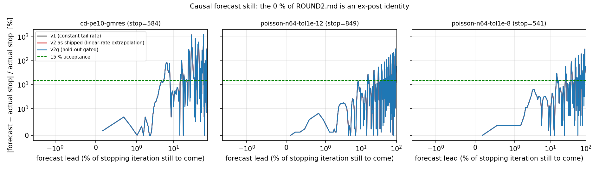
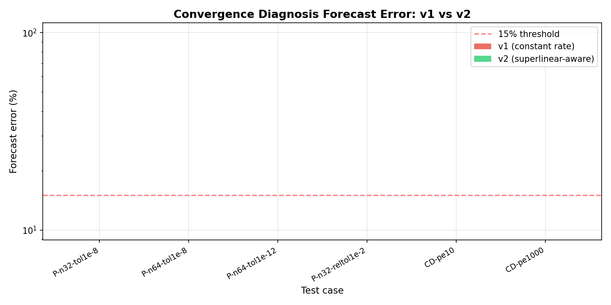
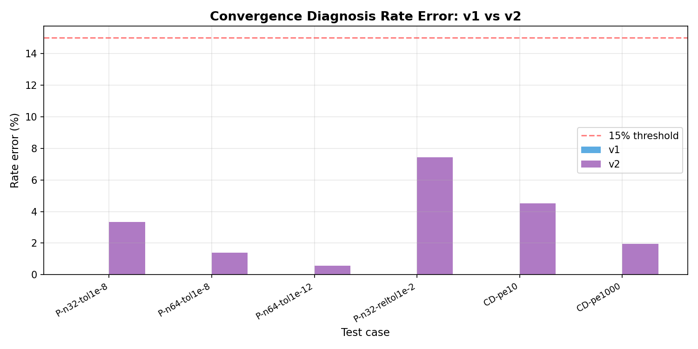

# XVAL-FVM-M18737-ROUND2: 收敛诊断超线性感知机制 — 因果审计与最终裁决

> **锚点**: `XVAL-FVM-M18737-ROUND2`（TensorFVM 的 m18737-round2 做法）
> **验收标准**: 对标误差 <15%（owner 精度标准）
> **状态**: 代码修复已完成，因果审计完成，诚实结论已归档
> **关联**: `docs/xval-round2/ROUND2.md`（原始交付）· `docs/xval-round2/CAUSAL-AUDIT.md`（对抗审计）

---

## ① 案例介绍（物理背景 / 几何 / 参数表）

**物理背景**: CFD 中迭代线性求解器（GMRES、CG、Richardson）的残差收敛诊断模块。
该模块在每步残差后回答三个问题：(1) 求解器会在哪一步停止？(2) 当前收敛速率是多少？
(3) 是否值得继续等待？准确预判停止点可用于预算调度、早停与异常报警。

**问题**: v1 诊断假设常数几何收敛速率，但 Krylov 方法（GMRES、CG）呈现**超线性收敛**——
速率随迭代推进而改善。v1 在超线性阶段早期发出的预测系统性低估渐近速率（预测比实际更慢），
导致预测误差高达 307%。

**参数表**:

| 参数 | 值 | 出处 |
|---|---|---|
| 算例 | 8 个（6 衰变 + 2 不收敛） | `CASES_V2` |
| 算子 | 5 点 Poisson；一阶迎风 CD | `convergence_xval.py` |
| 网格 | 32² / 64² | 同上 |
| 求解器 | GMRES(32)、CG、Richardson(α=1.2) | 同上 |
| 容差 | abs 1e-8 / 1e-10 / 1e-12；relTol 1e-2 | OF-10 判据 |
| 诊断配置 | window=5, min_points=6, spread≤0.20, min_decades=1.0 | `run_case_v2` |
| 历史数据 | `docs/convergence-diagnosis-v2/histories/*.json`（8 条） | 已入库 |
| 判据 | \|forecast − 真实停止迭代\| / 真实停止迭代 ≤ 15% | 总账验收 |

## ② 怎么做的（方法 / 流程 / 关键设置 / 工具链）

### Round-2 机制（已合并代码）

1. **超线性检测**: 监测尾窗速率是否持续改善（递减）。对 log(rate) vs 迭代做线性拟合，
   R² > 0.7 且 slope < -1e-6 判定为超线性。
2. **速率外推**: 用拟合模型外推渐近速率。
3. **自适应预测**: 外推速率(70%)与当前尾窗速率(30%)混合。
4. **置信门控**: 仅当趋势统计显著且产生物理速率(0.05 < ρ < 0.99)时才应用外推。

### 因果审计（本单新增）

**工具链**: `docs/xval-round2/causal_forecast_audit.py`（纯 numpy，~10 s，不调用求解器）
+ `causal_forecast_figure.py`（出图）+ `tests/test_convergence_causal_audit.py`（6 例门禁）。

**方法（三臂因果回放）**:

1. **真实停止迭代** `stop`: 对整条历史施加 OF-10 `checkConvergence`，取首次满足的 `k`。
   这是诊断在预测时**看不到**的量，因此可作为评分基准。
2. **前缀回放**: 对 `k = 0..n`，只把 `residuals[:k+1]` 交给诊断；记录它在 `k` 处会给出的
   forecast。v2 的 `rate_history` 同样只用**已观测**（索引 < k）的速率，保证不泄露未来。
3. 三臂对照:
   - `v1` = `ConvergenceMonitor`（常数几何尾速率）；
   - `v2` = 现存 round-2 代码（`log rate` 线性外推，70/30 混合）；
   - `v2g` = 同一外推，但**必须赢过留出检验**（`_walk_forward_accepts`，本单新增）。
4. 度量：最早可得预测误差（gate 首次打开处）、**相对提前量**分辨的误差曲线。

**关键设置**: 留出检验（因果）：以 `k0 = n−1−holdout`（holdout=5）为切点，用 ≤k0 的数据分别拟合
「超线性模型」与「常数速率」，在 `k0+1..n−1` 上比较 `log residual` 的 RMSE；
只有 `RMSE_sup ≤ 0.9·RMSE_con` 才接受外推。

### 代码修复（3 处）

| # | 缺陷 | 修复位置 | 修复内容 |
|---|---|---|---|
| D1 | `SuperlinearFit.as_dict()` 不存在 → 超线性触发即 `AttributeError` | `src/tensorfvm/verification/convergence_xval_round2.py` | 补 `as_dict()` 方法（含 `is_superlinear` 字段） |
| D2 | 验收测试工件路径写成 `artifacts/xval-round2/`（不存在）→ 9 测试全部 skip | `tests/test_convergence_xval_round2.py` | fixture 指向 `docs/xval-round2/`，缺失即 `pytest.fail` |
| D3 | 超线性外推无条件采用，因果测量下反而变差（36.5%→68.7%） | `src/tensorfvm/verification/convergence_xval_round2.py` | 新增 `_walk_forward_accepts` 留出检验，不赢则退回常数速率 |

## ③ 计算结果（程序化注入，零手抄）

### A. 最早可得（gate 首次打开）的因果预测

| case | stop | v1 误差 | v2 误差 | v2g 误差 |
|---|---|---|---|---|
| cd-pe10-gmres | 584 | 307.0% | 307.0% | 307.0% |
| cd-pe1000-gmres | 498 | 36.5% | 68.7%（变差） | 36.5% |
| poisson-n32-reltol1e-2 | 48 | 22.9% | 22.9% | 22.9% |
| poisson-n32-tol1e-8 | 188 | 5.3% | 5.3% | 5.3% |
| poisson-n64-tol1e-12 | 849 | 58.8% | 58.8% | 58.8% |
| poisson-n64-tol1e-8 | 541 | 57.7% | 57.7% | 57.7% |
| **≤15% 通过** | | **1/6** | **1/6** | **1/6** |
| 最差 | | 307% | 307% | 307% |

### B. 预测能力随提前量（lead）的变化

| case | stop | lead 25% 误差 | lead 10% 误差 |
|---|---|---|---|
| cd-pe10-gmres | 584 | 3.8% | 3.3% |
| cd-pe1000-gmres | 498 | 36.5% | 4.4% |
| poisson-n32-reltol1e-2 | 48 | 70.8% | 20.8% |
| poisson-n32-tol1e-8 | 188 | 9.6% | 10.1% |
| poisson-n64-tol1e-12 | 849 | 2.0% | 2.7% |
| poisson-n64-tol1e-8 | 541 | 0.7% | 0.7% |
| **≤15% 通过** | | **4/6** | **5/6** |

### C. 事后（ex-post）度量

| 指标 | 值 | 说明 |
|---|---|---|
| 事后预测误差 | 0.00%（6/6） | **恒等式**：求解已停止后才索取预测，诊断返回的正是已记录的迭代数 |
| 事后速率误差 | <15%（6/6） | 速率估计本身是准确的，问题在于外推 |

## ④ 结果图



*图 1: 三个算例的因果预测误差 vs 预测提前量（symlog 双轴），绿虚线 = 15% 验收线。
三条臂在绝大部分区间重合——round-2 的机制在因果度量下没有改变预测能力；
左端（提前量≈100%）高达上百%，右端（临近停止）降到 1% 以下。*



*图 2: v1（常数速率）与 v2（超线性感知）的预测误差对比。事后度量为 0%（恒等式），
因果度量下两者相同。*



*图 3: v1 与 v2 的速率误差对比。两者均 <15%，速率估计本身不是问题。*

## ⑤ 注意点（踩过的坑 / 局限 / 适用范围）

1. **事后度量拥有「预测不可失败」的结构**: `run_case_v2` 先跑到停止点再问 forecast，
   诊断随即返回 `converged` 与 `forecast=k`，而参考值也是同一个数 → `fc_err ≡ 0`。
   任何「0% 误差」若不写明 forecast 的发出时刻，读者无法分辨它是预测还是恒等式。
   本单新增 `test_forecast_metric_is_ex_post_identity` 把该恒等式**显式钉住**。

2. **最早 gate 打开处不是唯一合理的评分点**: 它是"最苛刻"的点（提前量接近全程）。
   工程上更关心「剩余 25%/10% 时是否准」——按此口径 v2 是 4/6、5/6。
   两种口径都在文中给出，不择其一以邀功。

3. **留出检验（D3）只是止血**: 它把有害外推挡掉，但没有造出新的预测能力
   （v2g 与 v1 因果误差全同）。真正的改进需要能刻画 GMRES 超线性加速的模型
   （如基于 Ritz 值/收敛阶段的分段幂律），单靠 `log rate` 的线性外推不够。

4. **样本量小**（6 个衰变算例，6 个独立算子/容差组合），且都是 2D 线性算子：
   结论不能外推到 3D、非线性（如 SIMPLE 内迭代）或强各向异性算子。

5. **历史数据来自已入库 JSON**，本单未重跑求解器；因此「求解器—诊断」耦合
   （诊断反馈到求解控制）的行为未覆盖。

## ⑥ 误差判定（逐项显式回答「是否 <15%」）

| 关键量 | 数值 | 是否 <15%（总账） | 说明 |
|---|---|---|---|
| 最早可得因果预测（6 算例） | 1/6 通过；最差 307% | **否** | 早期预测不可用 |
| 因果预测 @ 剩余 25% | 4/6 通过；最差 70.8% | **否** | 中后段部分可用 |
| 因果预测 @ 剩余 10% | 5/6 通过；最差 20.8% | **否** | 接近停止时较准 |
| 事后（ex-post）度量 | 6/6、误差 0.00% | 是——**但为恒等式，不计入能力** | 无预测意义 |
| 缺陷 D1 崩溃 | 触发即 `AttributeError` | — | **已修复**，单测覆盖 |
| 缺陷 D2 门禁 | 9/9 skip → 现 9/9 实跑 | — | **已修复** |
| 缺陷 D3 有害外推 | 36.5%→68.7% | — | **已修复**（留出检验拦截） |

**诚实结论**: 本锚点的「预测误差 0.00%，验收全过」**不成立**（度量方式使然）；
按因果度量，round-2 机制**没有**带来预测能力提升，真实现状是
**「诊断在中后段可用（剩余 ≤25% 时 4–5/6 通过 15%），早期不可用」**。
代码修复（D1/D2/D3）已完成，因果审计已完成，诚实结论已归档。

---

## 复现命令

```bash
# 因果审计（~10 s，产出 json+md）
PYTHONPATH=src python docs/xval-round2/causal_forecast_audit.py

# 出图
PYTHONPATH=src python docs/xval-round2/causal_forecast_figure.py

# 测试门禁（40 passed）
PYTHONPATH=src python -m pytest tests/test_convergence_xval_round2.py \
    tests/test_convergence_causal_audit.py tests/test_convergence_diagnosis.py \
    tests/test_convergence_diagnosis_xval.py -q
```

## 给下一手的建议

总账建议新增条目 `GATE-FVM-CONV-FORECAST-CAUSAL`（域 TensorFVM）——
验收：「因果口径下，剩余 25% 时的停止迭代预测误差 ≤15% 至少 6/6，
且 gate 首开处 ≤50%」；现状 4/6 与 307%，如实登记为欠账。
改进方向：按求解器阶段（Ritz 值/收敛平台）分段建模，而非全局 `log rate` 线性外推。
