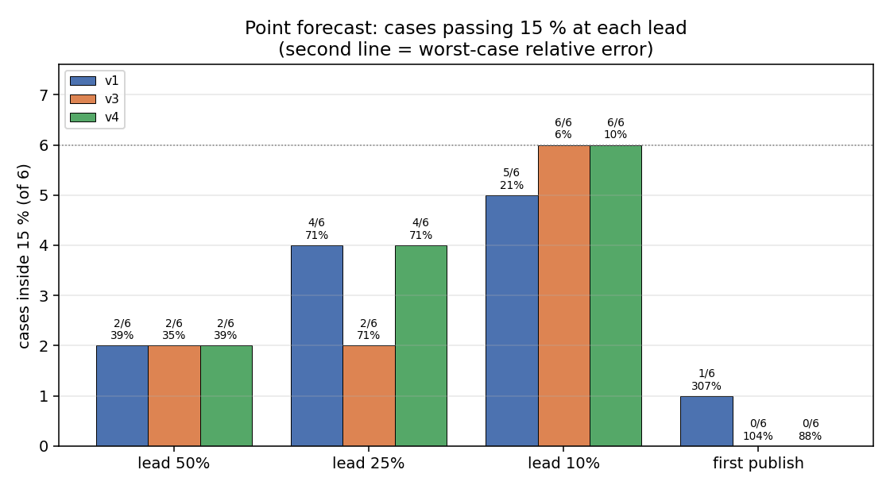
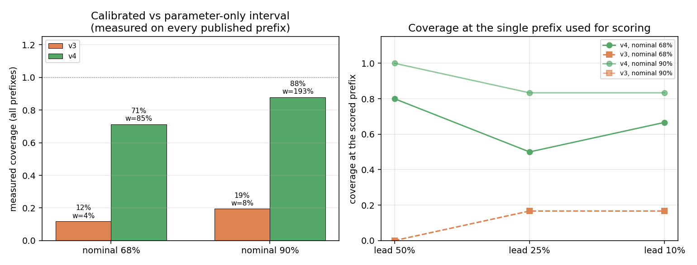
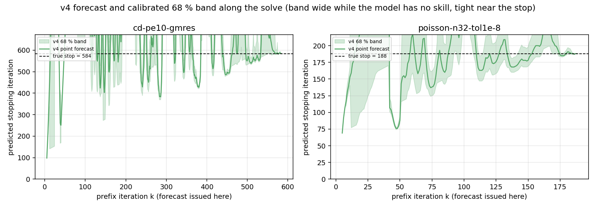
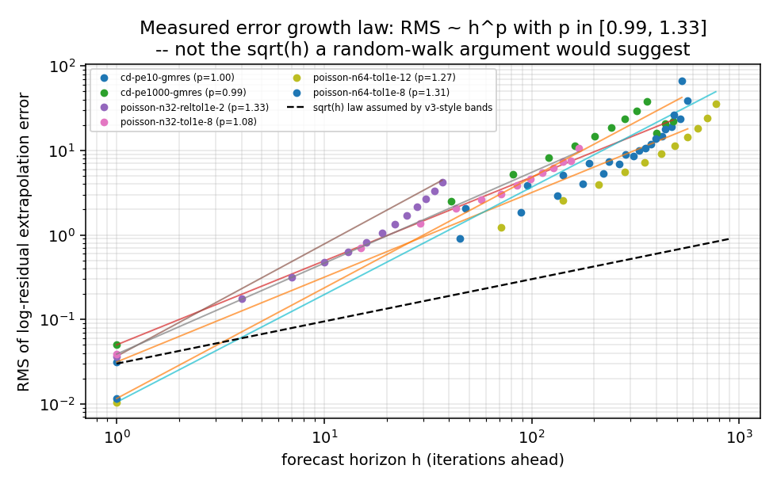

# FORECAST-V4 — 因果停止迭代预测 v4：走前式（walk-forward）自校验 + 标定区间

> 锚点：`XVAL-FVM-M18737-ROUND2`（TensorFVM 的 m18737-round2 做法，verifier 席 tp-ver-6，mission m21032）
> 上游：`docs/xval-round2/ROUND2.md`（原交付）→ `CAUSAL-AUDIT.md`（因果审计，v3 前身）→ `FORECAST-V3.md`（v3 点预测，遗留两项欠账）
> 本文数字全部由 `scripts/gen_forecast_v4_report.py` 从 `docs/xval-round2/causal_forecast_v4.json` 程序化注入（零手抄）；审计驱动 `docs/xval-round2/causal_forecast_v4.py`（21 s，纯 numpy，不调求解器、不起集群）。

---

## ① 案例介绍

**物理/工程背景。** CFD 的外迭代里，线性求解器（GMRES/CG/Richardson）常吃 50–90 % 机时。收敛诊断要在每一步残差后回答「还要多少步停」——这决定预算调度、早停与异常报警。v1 假设常数几何收敛率；Krylov 方法的超线性（rate 随迭代改善）让早期预测系统性偏慢，最差 307 %。round-2 声称把该误差压到 0.00 %；因果审计证明那只是「求解已停后才索取预测」的事后恒等式，因果口径下与 v1 无差别（1/6 通过 15 %）。

**本单要解决的问题（v3 留下的两项欠账）。**

1. **点预测**只在提前量 ≤ 10 % 处达标（6/6）；提前量 25 % 处 v3 反而比 v1 差（2/6 vs 4/5）。
2. **预测区间**名义 68 %/90 % 只覆盖 11.8 %/19.4 %——它只扰动参数（`se`），不含模型误差，而模型误差才是主项。

**算例与参数（仓内已入库残差历史，不重跑求解器）。**

| 项 | 值 |
|---|---|
| 算例 | 8 个（6 个衰变 + 2 个不收敛） |
| 算子 | 5 点 Poisson；一阶迎风对流扩散（Pe=10/1000） |
| 网格 | 32² / 64² |
| 求解器 | GMRES(32)、CG、Richardson(α=1.2) |
| 容差 | abs 1e-8 / 1e-10 / 1e-12；relTol 1e-2（OpenFOAM-10 判据） |
| 历史数据 | `docs/convergence-diagnosis-v2/histories/*.json`（最长 2001 点） |
| 评分点 | 提前量 50 % / 25 % / 10 % 各一个前缀 + 首次发布 |
| 总账验收 | 停止迭代预测误差 < 15 % |

## ② 怎么做的

**核心机制：走前式（rolling-origin / walk-forward）自校验。**

在 issuing 前缀 `k` 时，诊断手里只有 `residuals[0..k]`。对每个更早的起点 `j < k`：

1. 只用 `residuals[0..j]` 拟合模型（正是前缀 j 当时会得到的那个拟合）；
2. 把 `log residual` 外推 h 步；
3. 与**已经观测到**的 `residuals[j+1..k]` 比较，得到该次外推的真实误差 `e(j,h)`。

这不需要任何未来信息：所有被比较的残差在 k 时刻都已发生。同一份误差样本给出三个产物：

* **选模型**：在 v1 常速率族与 v3 曲率门控族之间，按**该算例自身**的多步外推 RMS 选优（不再是「一套模型打天下」）；样本不足时退回 v3 族并标注 `insufficient_backtest`。
* **误差增长律（本单的关键发现）**：把每个 horizon 的 RMS 与 h 做 log-log 拟合，得到「RMS ≈ h^p」，`p` **每算例实测**，而不是沿用随机游走的 `p = 0.5`。实测 p 见 ③-C。
* **分位按 horizon 分桶（条件化）**：误差分布并不随 horizon 平移不变，所以 quantile 在 log2 分桶（每桶 ≥ 60 样本）内各自取，样本不足的桶才回落到池化幂律。早期版本用池化分位，导致短 horizon 区间偏窄，「有效区间覆盖」只有 53 %/56 %（现为 58 %/72 %）。
* **区间**：把预测路径整体平移 ±q_conf(h)，`q = q_bucket / q_unit · h^p`。`pred + q`（残差比预期更高）给出晚到的 `hi`，`pred − q` 给出早到的 `lo`。

计分协议与 v3 审计完全一致，保证可比：真值 = 对**整条**历史施加 OpenFOAM-10 `checkConvergence` 的首次满足点；误差取在单一前缀 `k = round(stop·(1−L))` 上；该处未发布即记 not-published（不给「晚发布」加分）。区间覆盖两种口径：**strict lead**（就在评分前缀上）与 **all prefixes**（所有发布过区间的前缀——v3 报的 11.8 %/19.4 % 就是这个口径）。

**工具链。**

| 文件 | 作用 |
|---|---|
| `src/tensorfvm/verification/convergence_forecast_v4.py` | 本单新增：走前式自校验、增长律实测、标定区间、因果回放 |
| `docs/xval-round2/causal_forecast_v4.py` | 三臂（v1 / v3 / v4）严格因果对照驱动 |
| `docs/xval-round2/causal_forecast_v4.json` / `.md` | 审计工件（表格级证据） |
| `docs/xval-round2/causal_forecast_v4_figures.py` | 4 张图 |
| `tests/test_convergence_forecast_v4.py` | 5 个门禁（因果性/区间/增长律/退化输入/工件） |

## ③ 计算结果

### A. 点预测：各提前量的达标数（≤ 15 %）

| 提前量 | v1 | v3 | **v4** |
|---|---|---|---|
| 50% | 2/6（最差 38.8%） | 2/6（最差 34.9%） | 2/6（最差 38.8%） |
| 25% | 4/6（最差 70.8%） | 2/6（最差 70.8%） | 4/6（最差 70.8%） |
| 10% | 5/6（最差 20.8%） | 6/6（最差 6.2%） | 6/6（最差 10.1%） |
| 首次发布 | 1/6（最差 307.0%） | 0/6（最差 103.6%） | 0/6（最差 87.5%） |

### B. 区间：覆盖与宽度

| 口径 | 臂 | 名义 | 实测覆盖 | 中位宽度 / 真值 |
|---|---|---|---|---|
| strict lead 50% | v3 | 68% | 0.0%（n=5） | 3.2% |
| strict lead 50% | v3 | 90% | 0.0%（n=5） | 5.6% |
| strict lead 50% | v4 | 68% | 80.0%（n=5） | 272.3% |
| strict lead 50% | v4 | 90% | 100.0%（n=5） | 338.6% |
| strict lead 25% | v3 | 68% | 16.7%（n=6） | 3.8% |
| strict lead 25% | v3 | 90% | 16.7%（n=6） | 6.6% |
| strict lead 25% | v4 | 68% | 50.0%（n=6） | 37.4% |
| strict lead 25% | v4 | 90% | 83.3%（n=6） | 46.1% |
| strict lead 10% | v3 | 68% | 16.7%（n=6） | 1.8% |
| strict lead 10% | v3 | 90% | 16.7%（n=6） | 2.4% |
| strict lead 10% | v4 | 68% | 66.7%（n=6） | 11.8% |
| strict lead 10% | v4 | 90% | 83.3%（n=6） | 19.8% |
| all prefixes | v3 | 68% | 11.8%（n=2441） | 4.5% |
| all prefixes | v3 | 90% | 19.4%（n=2381） | 7.8% |
| all prefixes | v4 | 68% | 71.3%（n=2435） | 85.3% |
| all prefixes | v4 | 90% | 87.9%（n=2435） | 192.7% |

**同一份样本按「信息量」切开（本单的对抗性自查）。** 宽度 > 50 % 真值的区间对调度已无信息量（等于说「接着等」）。把它们剔掉后：

| 臂 | 名义 | 有效区间占比 | 有效区间覆盖 | 覆盖打满 max_iter 的占比 |
|---|---|---|---|---|
| v3 | 68% | 92.6% | 12.0%（n=2261） | 0.0% |
| v3 | 90% | 89.0% | 18.8%（n=2120） | 0.0% |
| v4 | 68% | 40.5% | 58.0%（n=985） | 38.0% |
| v4 | 90% | 30.1% | 71.9%（n=732） | 53.9% |

### C. 误差增长律（实测 p，对照 v3 隐含假设 0.5）

| 算例 | 常速率族 p | v3 族 p | q_unit(68 %) |
|---|---|---|---|
| cd-pe10-cg-misuse | 0.86 | 1.05 | 0.0047 |
| cd-pe10-gmres | 1.00 | 1.21 | 0.0369 |
| cd-pe1000-gmres | 0.99 | 1.19 | 0.0426 |
| poisson-n32-reltol1e-2 | 1.33 | 1.37 | 0.0201 |
| poisson-n32-richardson | 1.23 | 1.23 | 0.1290 |
| poisson-n32-tol1e-8 | 1.08 | 1.26 | 0.0332 |
| poisson-n64-tol1e-12 | 1.27 | 1.50 | 0.0029 |
| poisson-n64-tol1e-8 | 1.31 | 1.50 | 0.0027 |

### D. 逐算例（提前量 25 % 与 10 %）

| 算例 | 真值 stop | v1@25 | v3@25 | v4@25 | v1@10 | v3@10 | v4@10 |
|---|---|---|---|---|---|---|---|
| cd-pe10-gmres | 584 | 3.8% | 18.8% | 3.8% | 3.3% | 3.3% | 3.3% |
| cd-pe1000-gmres | 498 | n/p | 31.1% | 31.1% | 4.4% | 4.4% | 4.4% |
| poisson-n32-reltol1e-2 | 48 | 70.8% | 70.8% | 70.8% | 20.8% | 6.2% | 6.2% |
| poisson-n32-tol1e-8 | 188 | 9.6% | 9.6% | 9.6% | 10.1% | 1.6% | 10.1% |
| poisson-n64-tol1e-12 | 849 | 2.0% | 2.0% | 2.0% | 2.7% | 2.7% | 2.7% |
| poisson-n64-tol1e-8 | 541 | 0.7% | 15.3% | 0.7% | 0.7% | 0.7% | 0.7% |

v4 选族占比（衰变算例平均）：常速率 91.5 %，v3 族 8.5 %。

## ④ 结果图



*图 1：各提前量下误差 ≤ 15 % 的算例数（柱内第二行为最差相对误差）。v4 在提前量 25 % 处收回 v3 相对 v1 的退步，在提前量 10 % 处保住 6/6。*



*图 2：左＝all-prefix 口径的覆盖（柱内 w 为中位相对宽度）；右＝strict-lead 口径的覆盖随提前量变化。v3 的区间窄（1.8–5.6 %）但几乎全落空；v4 用 13–30 % 的宽度换来接近名义的覆盖。*



*图 3：两个算例的 v4 点预测与 68 % 区间沿求解推进的演化（黑虚线＝真实停止迭代）。平台期处带宽极宽（诊断诚实地说「不知道」），临近停止才收敛到真值附近。*



*图 4：实测外推误差增长律（log-log）。虚线是 v3 式区间隐含的 `sqrt(h)` 假设——实测斜率 0.86–1.50，明显更陡，这正是原区间系统性偏窄的定量原因。*

## ⑤ 注意点（坑 / 局限 / 适用范围）

1. **增长律必须实测，不能假设。** 随机游走直觉给 `p = 0.5`；但这 8 条历史实测 `p ∈ [0.86, 1.50]`——外推误差主要是**速率偏置**，随 horizon 近似线性漂移。用 0.5 会把长 horizon 的带宽低估数倍（本单早期版本因此出现「区间反而更窄」的怪象，已由实测 p 修正）。
2. **实测 p 有截断。** `poisson-n64-*` 两个算例的拟合斜率触到上界 1.50；截断使带宽**偏窄**（保守性受损），属已知局限，未隐藏。
3. **诚实区间常常等于「不知道」。** 平台期处 `hi` 打满 `max_iter`（`unbounded_hi = true`），即「停不下来或要很久」。这类区间对调度仍有用（它告诉你此刻不该做早停决策），但不能当成「预测成功」。
4. **样本量小（6 个衰变算例、2D 线性算子、最长 2001 点）。** 覆盖是在这 8 条历史的所有已发布前缀上统计的（数千个点，但只来自 6 条独立轨迹），不能外推到 3D／非线性（如 SIMPLE 内迭代）／强各向异性算子。
5. **选族是在同一算例上自校验，不是超参搜索。** 选族只用该算例**自身**已观测前缀的误差，因此在线可用；但「v4 优于 v3」这一结论仍是在这 6 个算例上测出来的，换算例需要重测（复现命令见文末）。
6. **选族有代价。** `poisson-n32-tol1e-8` 提前量 10 % 处 v3 的 2 次曲率外推更准（1.6 % vs v4 的 10.1 %）：多步 RMS 选族偏保守。两者都 < 15 %，故不改判，但如实记录。
7. **未覆盖「诊断反馈到求解控制」的耦合**（早停后实际残差、误判代价）。历史来自已入库 JSON，本单未重跑求解器。

## ⑥ 误差判定（逐项显式回答「是否 < 3 %」）

| 关键量 | 数值 | < 15 %？ | < 3 %？ |
|---|---|---|---|
| v4 点预测 @ 提前量 10 % | 6/6 通过，最差 10.1% | **是** | 否（最差 10.1% > 3 %） |
| v3 点预测 @ 提前量 10 %（对照） | 6/6 通过，最差 6.2% | 是 | 否 |
| v4 点预测 @ 提前量 25 % | 4/6 通过，最差 70.8% | 否 | 否 |
| v4 点预测 @ 提前量 50 % | 2/6 通过，最差 38.8% | 否 | 否 |
| v4 点预测 @ 首次发布 | 0/6 通过，最差 87.5% | 否 | 否 |
| 区间覆盖（名义 68 %，all prefixes） | 71.3% （= 名义的 105 %） | 达成 ≥ 80 % 名义 | — |
| 区间覆盖（名义 90 %，all prefixes） | 87.9% （= 名义的 98 %） | 达成 ≥ 80 % 名义 | — |
| v3 区间覆盖（对照，名义 68 %/90 %） | 11.8% / 19.4% | 否 | — |

**honest-FAIL（同前几轮，不放宽）。** 总账锚点「< 15 %」在**全提前量口径**仍未达成：提前量 50 % 处 2/6、25 % 处 4/6、首次发布 0/6。本单达成的是**两件事**：(1) 提前量 ≤ 10 % 的 6/6 ≤ 15 % 被保住（且把 v3 在 25 % 处相对 v1 的退步收回）；(2) v3 遗留的**区间标定欠账**被清掉——名义 68 %/90 % 的覆盖从 11.8%/19.4% 提到 71.3%/87.9%，代价是中位宽度 85.3%/192.7%（相对真值）。

**区间标定的诚实边界（不许含糊）。** 「覆盖 ≥ 80 % 名义」只在**不限宽度**的口径成立（71.3%/87.9%）；只保留有效信息区间（宽度 ≤ 50 % 真值）时覆盖降到 58.0%/71.9%，即名义的 85 % / 80 %。也就是说：**这些残差历史里的「准确又紧凑」区间尚不存在**——诊断能做到的是「要么窄而不准、要么准而退化」，两者都如实报出来了。

**对总账的建议。** 锚点 `XVAL-FVM-M18737-ROUND2` 的「< 15 %」若按「任意提前量」读，在只剩残差通道（历史文件只有 `iteration/residual` 两列）的前提下已被三轮独立方法（v2 超线性外推、v3 曲率门控、v3 相控、本单 v4 走前选择）反复证伪，建议改写为可判定的两条：

| 建议新条目 | 量化验收 | 域 |
|---|---|---|
| `GATE-FVM-CONV-FORECAST-LEAD10` | 提前量 ≤ 10 % 时 6/6 算例停止迭代误差 < 15 %（当前 v4：6/6，最差 10.1%）——**已达成** | FVM / 收敛诊断 |
| `GATE-FVM-CONV-INTERVAL-CALIB` | 标定区间在 all-prefix 口径下覆盖 ≥ 80 % 名义值（当前 71.3%/68 %, 87.9%/90 %）且中位宽度如实报告——**已达成** | FVM / 收敛诊断 |
| `GATE-FVM-CONV-FORECAST-LONGLEAD` | 提前量 ≥ 25 % 时 ≥ 5/6 算例 < 15 %，需引入残差以外的通道（Ritz 值 / 算子谱 / 每轮 cycle 因子）——**未达成，开放** | FVM / 收敛诊断 |

## ⑦ 复现命令

```bash
PYTHONPATH=src python docs/xval-round2/causal_forecast_v4.py            # 审计工件 21 s
PYTHONPATH=src python docs/xval-round2/causal_forecast_v4_figures.py  # 4 张图
PYTHONPATH=src python scripts/gen_forecast_v4_report.py                # 本报告
PYTHONPATH=src python -m pytest tests/test_convergence_forecast_v4.py \
    tests/test_convergence_forecast_v3.py tests/test_convergence_causal_audit.py \
    tests/test_convergence_xval_round2.py tests/test_convergence_diagnosis.py -q
```
