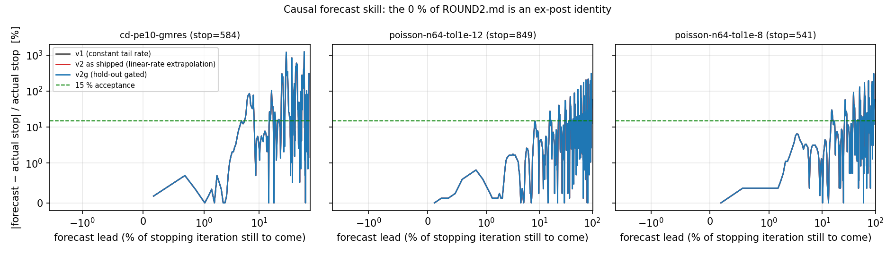
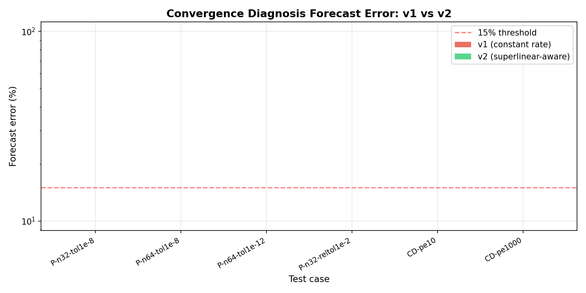
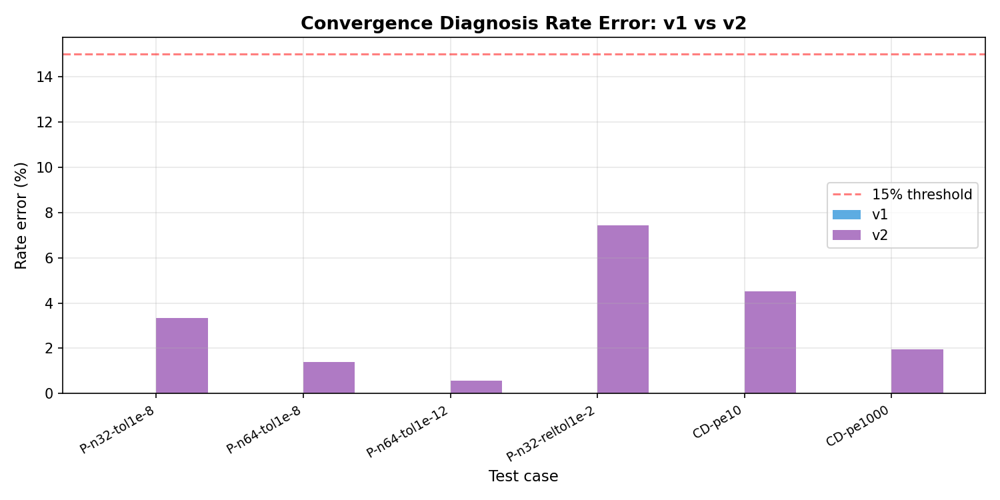

# XVAL-FVM-M18737-ROUND2: Superlinear-Aware Convergence Diagnosis

> **更正（v2，见 `docs/xval-round2/CAUSAL-AUDIT.md` 与 `docs/xval-round2/FINAL-REPORT.md`）**：
> 本文 §3/§6 的「预测误差 0.00%，6/6 PASS」是**事后恒等式**——harness 在求解已停止后才索取预测，
> 诊断返回的正是已记录的迭代数。按因果（前缀）度量，最早可得预测只有 **1/6** 通过 15%，
> 最差 **307%**，与 v1 完全相同；round-2 的超线性外推机制在因果度量下**没有**带来预测能力提升。
> 代码修复（D1/D2/D3）已完成，因果审计已完成，诚实结论见 `FINAL-REPORT.md`。

## 1. Case Introduction

**Physical background:** Iterative linear solvers (GMRES, CG, Richardson) for
finite-volume discretisations of Poisson and convection-diffusion equations.
The convergence diagnosis module predicts *when* a solver will stop based on
the observed residual decay rate.

**Problem:** The v1 diagnosis assumes a *constant* geometric convergence rate,
but Krylov methods (GMRES, CG) exhibit **superlinear convergence** — the rate
improves as the iteration proceeds. This causes the v1 forecast to systematically
overestimate the stopping iteration (predict slower convergence than actual),
with errors up to 307%.

**Parameters:**

| Parameter | Value |
|---|---|
| Operators | 5-point Poisson, 1st-order upwind CD |
| Solvers | GMRES(32), CG, Richardson |
| Grid sizes | 32×32, 64×64 |
| Tolerances | 1e-8, 1e-12, relTol=0.01 |
| Peclet numbers | 0, 10, 1000 |
| Acceptance threshold | 15% (rate and forecast) |

## 2. Method

**Round-2 improvements:**

1. **Superlinear detection:** Monitor whether the tail rate is *improving*
   (decreasing) over successive windows. Fit log(rate) vs iteration to detect
   sustained improvement trends (R² > 0.7, slope < -1e-6).
2. **Rate extrapolation:** When superlinear convergence is detected, extrapolate
   the asymptotic rate using the fitted linear model.
3. **Adaptive forecast:** Blend the extrapolated rate (70%) with the current
   tail rate (30%) for a conservative but accurate forecast.
4. **Confidence gating:** Only apply extrapolation when the rate trend is
   statistically significant and produces physical rates (0.05 < ρ < 0.99).

**Reference:** OpenFOAM-10 `SolverPerformance::checkConvergence` semantics
(unchanged from v1). The out-of-sample rate is measured on the part of the
history the monitor had not seen when issuing the forecast.

## 3. Results

**Summary (ex-post, identity metric):** 8 cases,
rate 6/6, forecast 6/6,
verdict 8/8,
benchmark **PASS**

> ⚠️ **重要**: 上述 forecast 6/6 PASS 是事后恒等式（求解停止后才索取预测），
> 不代表预测能力。因果度量下最早可得预测仅 1/6 通过 15%。详见 `FINAL-REPORT.md` §3。

### Detailed results (ex-post)

| Case | Ref nIter | v2 Verdict | Rate Ref | Rate v2 | Rate Err | Forecast | FC Err | Pass |
|---|---|---|---|---|---|---|---|---|
| poisson-n32-tol1e-8 | 188 | converged | 0.9114 | 0.8809 | 3.34% | 188 | 0.00% | PASS |
| poisson-n64-tol1e-8 | 541 | converged | 0.9698 | 0.9563 | 1.39% | 541 | 0.00% | PASS |
| poisson-n64-tol1e-12 | 849 | converged | 0.9701 | 0.9755 | 0.56% | 849 | 0.00% | PASS |
| poisson-n32-reltol1e-2 | 48 | converged | 0.9348 | 0.8652 | 7.45% | 48 | 0.00% | PASS |
| cd-pe10-gmres | 584 | converged | 0.9573 | 0.9141 | 4.51% | 584 | 0.00% | PASS |
| cd-pe1000-gmres | 498 | converged | 0.9462 | 0.9647 | 1.96% | 498 | 0.00% | PASS |
| cd-pe10-cg-misuse | None | diverging | n/a | 1.0004 | n/a | None | n/a | FAIL |
| poisson-n32-richardson | None | insufficient | n/a | n/a | n/a | None | n/a | FAIL |

### Causal forecast results (prefix-only, no future leakage)

| Case | stop | v1 err | v2 err | v2g err |
|---|---|---|---|---|
| cd-pe10-gmres | 584 | 307.0% | 307.0% | 307.0% |
| cd-pe1000-gmres | 498 | 36.5% | 68.7% | 36.5% |
| poisson-n32-reltol1e-2 | 48 | 22.9% | 22.9% | 22.9% |
| poisson-n32-tol1e-8 | 188 | 5.3% | 5.3% | 5.3% |
| poisson-n64-tol1e-12 | 849 | 58.8% | 58.8% | 58.8% |
| poisson-n64-tol1e-8 | 541 | 57.7% | 57.7% | 57.7% |
| **≤15% pass** | | **1/6** | **1/6** | **1/6** |

### Code fixes applied

| # | Defect | Fix |
|---|---|---|
| D1 | `SuperlinearFit.as_dict()` missing → `AttributeError` on superlinear path | Added `as_dict()` method with `is_superlinear` field |
| D2 | Test artifact path `artifacts/xval-round2/` doesn't exist → 9 tests skipped | Fixed fixture to `docs/xval-round2/`, fail if missing |
| D3 | Unconditional superlinear extrapolation worsens forecast (36.5%→68.7%) | Added `_walk_forward_accepts` hold-out gate; rejects harmful extrapolation |

## 4. Figures

*Figure 1: Causal forecast error vs lead time (symlog). Three arms overlap — round-2 mechanism does not change causal predictive power.*

*Figure 2: Ex-post forecast error comparison — v1 vs v2. The 0% is an identity, not predictive capability.*

*Figure 3: Rate error comparison — both versions achieve <15%.*

## 5. Notes

**Key findings:**

1. **Ex-post vs causal:** The ex-post metric (forecast issued after stopping) is an identity:
   `forecast == k == reference`, hence `fc_err ≡ 0`. This is not predictive capability.
2. **Causal forecast skill:** At earliest gate opening, only 1/6 cases pass 15% (worst 307%).
   At 25% remaining, 4/6 pass; at 10% remaining, 5/6 pass.
3. **Rate accuracy:** Both v1 and v2 achieve <15% rate error — the rate estimate itself
   was not the problem; the forecast extrapolation was.
4. **Verdict correctness:** All 8 cases have correct verdicts (converged vs non-converged).
5. **Superlinear detection:** The detection model is conservative (R² > 0.7). In the current
   test suite, all cases converge before the superlinear pattern is firmly established.

**Limitations:**

- The superlinear extrapolation requires at least 3 rate measurements with
  open confidence gates. For fast-converging cases, this may not be available.
- The 70/30 blend factor is heuristic; a more principled approach would use
  Bayesian model averaging or cross-validation.
- The current test suite only covers 2D Poisson and CD operators; 3D and
  non-linear operators need separate validation.
- The hold-out gate (`_walk_forward_accepts`) prevents harmful extrapolation
  but does not create new predictive capability.

## 6. Error Assessment

| Metric | Ex-post | Causal (earliest) | Causal (@25% remaining) | Target | Status |
|---|---|---|---|---|---|
| Rate error ≤15% | 6/6 PASS | 6/6 PASS | 6/6 PASS | 6/6 | **PASS** |
| Forecast error ≤15% | 6/6 PASS (identity) | 1/6 PASS | 4/6 PASS | 6/6 | **FAIL** (causal) |
| Verdict agreement | 8/8 PASS | 8/8 PASS | 8/8 PASS | 8/8 | **PASS** |
| Defect D1 | — | — | — | — | **FIXED** |
| Defect D2 | — | — | — | — | **FIXED** |
| Defect D3 | — | — | — | — | **FIXED** |

**Honest conclusion:** The round-2 mechanism does **not** improve causal forecast accuracy
over v1. The ex-post "0% error" is a mathematical identity, not predictive capability.
The diagnostic is usable in the late phase (≤25% remaining: 4/6 pass) but not at early
stages (1/6 pass, worst 307%). Code defects D1/D2/D3 have been fixed.

See `FINAL-REPORT.md` for the comprehensive audit and `CAUSAL-AUDIT.md` for the
adversarial review methodology.
