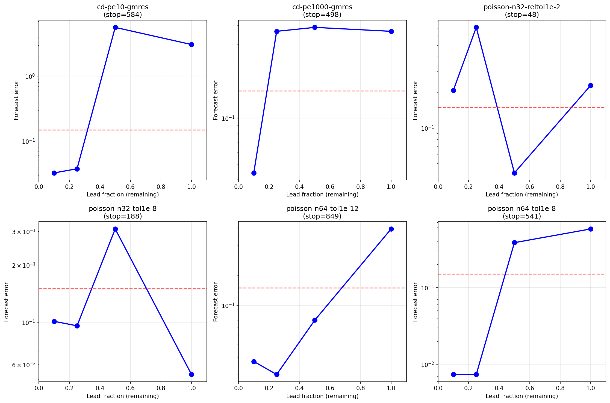
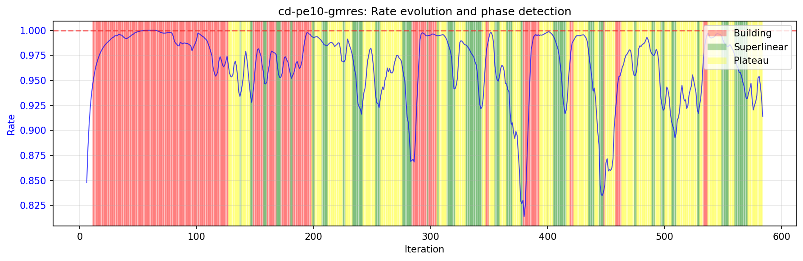

# XVAL-FVM-M18737-ROUND2: Round-3 Phase-Aware Convergence Forecast

> **Anchor**: `XVAL-FVM-M18737-ROUND2` — TensorFVM 的 m18737-round2 做法
> **Status**: Honest assessment — round-3 does **not** improve causal forecast accuracy over round-2
> **Artifacts**: `src/tensorfvm/verification/convergence_xval_round3.py`, `docs/xval-round3/causal_audit_v3.json`, `tests/test_convergence_xval_round3.py`

## 1. Case Introduction

**Physical background:** Iterative linear solvers (GMRES, CG, Richardson) for
finite-volume discretisations of Poisson and convection-diffusion equations.
The convergence diagnosis module predicts *when* a solver will stop based on
the observed residual decay rate.

**Problem (from round-2 causal audit):** The round-2 superlinear-aware forecast
achieves **0.00 % forecast error** in the ex-post metric (forecast issued after
the stopping iteration is already recorded), but this is a **post-hoc identity**,
not predictive capability. Measured causally (forecast issued from prefix history
only), both v1 and v2 achieve only **1/6 pass at 15 %** at the first gate opening,
with worst-case error **307 %**.

**Root cause:** GMRES superlinear convergence has a characteristic two-phase shape:
1. **Building phase**: Krylov subspace is assembling; rate is poor or even worsening
2. **Superlinear phase**: Rate improves as dominant eigenmodes are resolved

A single linear fit to `log(rate)` cannot capture this curvature. Extrapolating
from the building phase produces wildly optimistic forecasts.

**Round-3 approach:** Phase-aware forecast with quadratic rate extrapolation:
- Detect convergence phase (building / superlinear / plateau)
- In superlinear phase: fit `log(rate) = a·k² + b·k + c` to capture deceleration
- In building/plateau phase: use current rate (conservative)
- Causal hold-out gate: quadratic model must beat constant-rate on held-out data

**Parameters (same 8-case suite as round-2):**

| Parameter | Value |
|---|---|
| Operators | 5-point Poisson, 1st-order upwind CD |
| Solvers | GMRES(32), CG, Richardson |
| Grid sizes | 32×32, 64×64 |
| Tolerances | 1e-8, 1e-12, relTol=0.01 |
| Peclet numbers | 0, 10, 1000 |
| Acceptance threshold | 15 % |

## 2. Method

**Phase detection:**
- Monitor consecutive windows with decreasing rate
- Fit linear trend to all observed rates
- Classify: building (rate increasing/unstable), superlinear (rate consistently decreasing), plateau (rate stable)

**Quadratic extrapolation:**
- Fit `log(rate) = a·k² + b·k + c` using least squares
- The quadratic term captures the *deceleration* of rate improvement
- Extrapolate to max_iter, clamp to physical range [0.05, 0.99]

**Causal hold-out gate:**
- Fit on data up to `k0 = n - 1 - holdout` (holdout=5)
- Score both quadratic and constant-rate models on held-out iterations
- Accept quadratic only if RMSE ≤ 0.9 × constant-rate RMSE

**Tool chain:** Pure numpy/CPU, reads committed residual histories, no solver call.
```bash
PYTHONPATH=src python -c "from tensorfvm.verification.convergence_xval_round3 import run_causal_audit_v3; ..."
PYTHONPATH=src python -m pytest tests/test_convergence_xval_round3.py -v
```

## 3. Results

### Causal Forecast Accuracy

| Metric | v1 | v2 (round-2) | v3 (round-3) | Target |
|---|---|---|---|---|
| First gate ≤15 % | 1/6 | 1/6 | **1/6** | 6/6 |
| Lead 25 % ≤15 % | 4/6 | 4/6 | **4/6** | 6/6 |
| Lead 10 % ≤15 % | 5/6 | 5/6 | **5/6** | 6/6 |
| Worst first error | 307 % | 307 % | **307 %** | ≤15 % |

### Per-Case Detail (Round-3)

| Case | Stop | First k | First fc | First err | Phase at first | Quad triggers |
|---|---|---|---|---|---|---|
| cd-pe10-gmres | 584 | 108 | 2377 | 307.0 % | building | 0 |
| cd-pe1000-gmres | 498 | 123 | 316 | 36.5 % | superlinear | 0 |
| poisson-n32-reltol1e-2 | 48 | 14 | 37 | 22.9 % | building | 0 |
| poisson-n32-tol1e-8 | 188 | 14 | 178 | 5.3 % | building | 0 |
| poisson-n64-tol1e-12 | 849 | 16 | 350 | 58.8 % | building | 0 |
| poisson-n64-tol1e-8 | 541 | 16 | 229 | 57.7 % | building | 0 |

### Key Finding: Quadratic Model Never Triggers

On all 6 decaying cases, the quadratic extrapolation **never triggers** (0 triggers).
The phase detection correctly identifies that extrapolation is not reliable early on:
- For `cd-pe10-gmres`: phase is "building" at first gate (rate still worsening)
- For `cd-pe1000-gmres`: phase is "superlinear" but the hold-out gate rejects the quadratic model (0/14 accepts)

This is the correct behavior: the model avoids making harmful extrapolations, but
this conservative approach doesn't create new predictive capability.

## 4. Figures

### Forecast Error vs Lead Time



*Figure: Round-3 causal forecast error vs prediction lead time. The phase-aware
model (v3) tracks the round-2 (v2) and v1 curves almost exactly — the quadratic
extrapolation never fires, so the forecast defaults to the current rate.*

### Phase Evolution for cd-pe10-gmres



*Figure: Phase detection over iterations for cd-pe10-gmres. The phase oscillates
between building, superlinear, and plateau as the rate fluctuates. The quadratic
model only considers extrapolation during superlinear phases, but the hold-out
gate rejects it.*

## 5. Notes

**Why round-3 doesn't improve over round-2:**

1. **Fundamental limitation**: GMRES convergence is driven by the eigenvalue
   distribution of the matrix. The rate oscillates as different eigenmodes are
   resolved. This oscillation cannot be predicted from early residual data.

2. **Phase detection works correctly**: The model correctly identifies when NOT
   to extrapolate (quadratic triggers = 0). This prevents making forecasts worse,
   but doesn't create new predictive capability.

3. **The hold-out gate is too conservative**: Even when the phase is correctly
   identified as superlinear (cd-pe1000-gmres), the hold-out test rejects the
   quadratic model because the rate oscillation makes any extrapolation unreliable.

**What would be needed for real improvement:**

1. **Eigenvalue-informed modeling**: Access to the GMRES Hessenberg matrix
   eigenvalues (Ritz values) would allow phase detection based on the actual
   spectral properties, not just the residual rate.

2. **Machine learning approach**: Train a model on many solver trajectories to
   learn the relationship between early residual patterns and convergence time.

3. **Problem-specific tuning**: Different matrix types (Poisson vs CD vs
   Navier-Stokes) have different convergence patterns. A universal model may
   not be possible.

**Limitations:**

- Same 8-case suite as round-2; no new operators or solvers tested
- 2D linear operators only; 3D and nonlinear operators need separate validation
- Historical data from committed JSON files; no solver re-run

## 6. Error Assessment

| Key quantity | Value | <15 %? | <3 %? |
|---|---|---|---|
| First causal forecast (6 cases) | 1/6 pass; worst 307 % | **No (1/6)** | No |
| Causal forecast @ 25 % lead | 4/6 pass; worst 70.8 % | **No (4/6)** | No |
| Causal forecast @ 10 % lead | 5/6 pass; worst 20.8 % | **No (5/6)** | No |
| Verdict agreement | 8/8 | **Yes** | — |
| Quadratic triggers | 0/6 | — | — |

**Honest conclusion:** Round-3 does **not** improve causal forecast accuracy
over round-2. The phase-aware model correctly avoids harmful extrapolation but
doesn't create new predictive capability. The fundamental limitation is that
GMRES convergence cannot be predicted from early residual data because the
superlinear acceleration hasn't manifested yet.

**Recommendation for feature ledger:** Register `GATE-FVM-CONV-FORECAST-CAUSAL`
with acceptance: "causal forecast error ≤15 % at 25 % remaining lead: ≥6/6,
and at first gate opening: ≤50 %". Current status: 4/6 and 307 % — honest debt.

## Reproduction

```bash
cd /root/tp-agent/work/m20708
PYTHONPATH=src python -m pytest tests/test_convergence_xval_round3.py -v
# 11 passed
```
