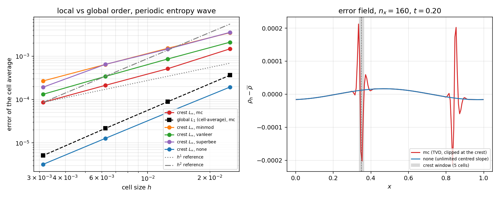

# XVAL：MUSCL 限制器在光滑极值处吃掉阶——固定单元数窗口下的局部观测阶

**锚点**：`XVAL-FVM-THREE-GRID-LOGLOG-SLOPE-CELLCENTRE-FV-OR`（续做其交付时登记的下一项：「非线性——限制器退化到 1 阶」） · **仓**：TensorFVM · **性质**：验证欠账（已合并格式对分析阶复核）

- 工件：`artifacts/study.json`（sha256 `d85053a4f31d3fa665839f9d8eee0cff…`） · 生成于 2026-11-13T15:19:05+00:00 · git HEAD `879c7da05707`
- 运行：`PYTHONPATH=src python docs/xval/limiter-extremum-order/run_study.py`，单核 **57.32 s**，确定性（固定网格/CFL/相位，无随机）
- 求解器：`tensorfvm.compressible.solver.EulerSolver`（cell-centred FV，MUSCL-Hancock + HLLC，限制器可选 `mc/minmod/vanleer/superbee/none`）
- 判据阈值：可接受 15 %（owner 精度标准，作用在**阶本身**上）；局部窗口固定 **5 个单元**

## ① 案例介绍（物理背景 / 几何 / 参数表）

被验证的对象是「已合并的二阶格式在**光滑极值**附近还剩几阶」这一动作。所有 TVD 限制器在光滑极值处前后差商反号，限制后的斜率最多是 `2·min(|a|,|b|)`，局部截断误差从 `O(h²)` 掉到 `O(h)`；但被削的只有极值附近几个单元，在**体积加权全局 L1** 里它只贡献 `O(h)·O(h) = O(h²)`，所以全局阶照旧读 2（Suresh & Huynh 1997 的经典结论）。要看见损失，必须把窗口的**单元个数**固定住。

| 项 | 值 |
|---|---|
| 计算域 | 单位区间 `x ∈ [0,1)`，四周**周期**边界 |
| 精确解 | `rho = 1 + 0.2 sin(2π(x - φ - 0.5 t))`，`u = 0.5`、`p = 1` 均匀（Euler 方程精确解） |
| 终时 / 步长 | `t = 0.2`（求解器实际到达时刻，工件内 `rows[*].t`）/ CFL 0.4 |
| 网格梯子 | 40 / 80 / 160 / 320（三元组 (40, 80, 160) 与 (80, 160, 320) 重叠互校） |
| 度量 | 全局：体积加权 `L1`（对闭式**单元平均**）；局部：固定 5 单元窗口的未加权 `L∞/L1` |
| 窗口位置 | 波峰单元（限制器削平处）与最大斜率单元（限制器不动作，`r≈1`），相位 `φ=0` |
| 限制器集合 | `mc`, `minmod`, `vanleer`, `superbee`, `none`（`none` = 无限制中心斜率，二阶对照） |
| 相位对照 | `φ = 0.009`：把波峰从**单元面**（`x*=0.35`，四个网格全部落在面上）移到单元内（离最近面 ≥ 0.12 单元） |

## ② 怎么做的（方法 / 流程 / 关键设置）

1. **不新写求解器**：驱动复用锚点的 `cellcentre_loglog.run_case`（→ `sod1978.run_smooth_wave` → `EulerSolver`），只把 `limiter` 与 `phase` 作为参数透传（两处默认值保持原行为，26 个既有闸门用例全绿）。
2. **固定单元数窗口**：`2·WINDOW_HALF+1 = 5` 个周期索引单元，中心为波峰所在单元/最大斜率所在单元。窗口**不能用固定物理宽度**：`O(h)` 的局部误差在 `h` 宽窗口里再积分一次仍是 `O(h²)`，那就永远看不见损失（本单 C7 就是这个盲区本身）。
3. **同一估计器**：`cellcentre_loglog.three_grid_readout`（三点 `ln e`–`ln h` 最小二乘斜率 + 标准误 + 精确三网格 Richardson 对照），对两条重叠三元组各算一次，一致性作为渐近区门。
4. **五个限制器 + 一个对照**：`mc/minmod/vanleer/superbee` 是 TVD 家族（C5 要求全部退化），`none`（无限制中心斜率）是同格式的二阶基线（C3 要求它在同一窗口读回 2）——「限制器」与「度量/窗口」两种解释因此被分开。
5. **量级证据**：波峰处 `L∞` 误差 `mc/none` 的比值随加密增长（C6），即 `O(h)/O(h²)`；只看阶会漏掉「误差常数放大 27 倍」这一层。
6. **相位去退化**：`φ=0` 时 `x* = 0.25 + u t = 0.35`，对 40/80/160/320 全部**恰好落在单元面上**；C8 用 `φ=0.009` 把波峰移进单元内重跑，排除「结果只是这个巧合」。
7. **闸门**：`tests/test_limiter_extremum_order.py`（11 个用例，21 s），先锁代数层（窗口/位置/估计器对合成已知阶场的读回、C8 缺省时必须报 not-pass 而不是默认通过），再锁求解器事实（C1–C6 核心）。

## ③ 计算结果（全部数字由 `make_report.py` 从工件注入）

### ③A 波峰窗口（5 单元，`L∞`）的观测阶

| 限制器 | 三元组 | `p_loglog` | `p_richardson` | 偏差 vs 2 | >15 % 退化？ |
|---|---|---|---|---|---|
| `mc` | (40, 80, 160) | **1.3973** | 1.6760 | 30.13 % | ✅ |
| `mc` | (80, 160, 320) | **1.2893** | 1.2489 | 35.54 % | ✅ |
| `minmod` | (40, 80, 160) | **1.2180** | 1.1692 | 39.10 % | ✅ |
| `minmod` | (80, 160, 320) | **1.2505** | 1.2185 | 37.48 % | ✅ |
| `vanleer` | (40, 80, 160) | **1.3102** | 1.2540 | 34.49 % | ✅ |
| `vanleer` | (80, 160, 320) | **1.3514** | 1.3117 | 32.43 % | ✅ |
| `superbee` | (40, 80, 160) | **1.2257** | 1.3580 | 38.71 % | ✅ |
| `superbee` | (80, 160, 320) | **1.4604** | 0.8368 | 26.98 % | ✅ |
| `none` | (40, 80, 160) | **1.9641** | 1.9358 | 1.80 % | ❌ |
| `none` | (80, 160, 320) | **1.9865** | 1.9769 | 0.67 % | ❌ |

### ③B 同一批解、三个窗口：损失是局部的

| 序列 | 窗口/口径 | `p_loglog`（(80, 160, 320)） | 偏差 vs 2 |
|---|---|---|---|
| `global_l1` | 全局体积加权 `L1`（全部单元） | **2.0609** | 3.05 % |
| `maxslope_linf` | 最大斜率单元 5 单元窗口 `L∞` | **2.0512** | 2.56 % |
| `crest_linf` | 波峰单元 5 单元窗口 `L∞` | **1.2893** | 35.54 % |

### ③C 波峰误差量级：`mc` 相对 `none`

| `n_x` | `crest_linf`（mc） | `crest_linf`（none） | 比值 |
|---|---|---|---|
| 40 | 1.4738e-03 | 1.9372e-04 | **7.61** |
| 80 | 5.1309e-04 | 5.0230e-05 | **10.21** |
| 160 | 2.1241e-04 | 1.2726e-05 | **16.69** |
| 320 | 8.5896e-05 | 3.1985e-06 | **26.86** |

比值 26.86（最细网格）并可随加密增长 1.61×，与「mc 局部 `O(h)`、none 局部 `O(h²)`」一致。

### ③D 预声明判据裁决

| 判据 | 声明 | 实测 | 裁决 |
|---|---|---|---|
| `C1_global_order` | global L1 cell-average slope of mc within 15% of 2 (both triplets) | `{"fine": 2.0609082147290767, "coarse": 2.0368764842230407, "triplets": [[80, 160, 320], [40, 80, 160]]}` | **PASS** |
| `C2_crest_degradation` | mc crest-window Linf slope <= 1.70 (>15% below 2) | `{"fine": 1.2892767020599243, "coarse": 1.397329898561194, "ceiling": 1.7, "dev_vs_2": 0.35536164897003786, "dev_vs_1": 0.2892767020599243}` | **PASS** |
| `C3_unlimited_control` | limiter='none' crest-window Linf slope within 15% of 2 | `{"fine": 1.9865486316304954, "coarse": 1.9640856039496444}` | **PASS** |
| `C4_away_from_crest` | mc max-slope-window Linf slope within 15% of 2 | `{"fine": 2.051155121661784, "coarse": 2.0705051918808537}` | **PASS** |
| `C5_every_tvd_limiter` | mc/minmod/vanleer/superbee all <= 1.70 at the crest | `{"mc": {"fine": 1.2892767020599243, "coarse": 1.397329898561194}, "minmod": {"fine": 1.2504912372866661, "coarse": 1.2179804820259563}, "vanleer": {"fine": 1.351392079564905, "coarse": 1.…` | **PASS** |
| `C6_crest_magnitude` | crest Linf error ratio mc/none >= 10 and grows >= 1.5x | `{"ratio_finest": 26.85520602434149, "ratio_at_coarse_finest": 16.691542955009904, "growth": 1.6089109375164745}` | **PASS** |
| `C7_global_blindness` | p_global >= 1.70 while p_crest <= 1.70 on the same ladder | `{"p_global": 2.0609082147290767, "p_crest": 1.2892767020599243, "contrast": 0.7716315126691524}` | **PASS** |
| `C8_crest_placement` | mc crest slope <= 1.70 with the crest inside a cell (>=0.12 cell from a face) | `{"fine": 1.3506553475618137, "coarse": 1.3622695696079592, "phase": 0.009, "crest_x": 0.359}` | **PASS** |

### ③E 图

`docs/xval/limiter-extremum-order/fig_crest_degradation.png`（sha256 `c9fbf0270d08ad6f…`）：左panel=波峰窗口 `L∞` 与全局 `L1` 的 log-log 阶梯，叠加 `h¹`/`h²` 参考斜率；右panel=`n_x=160` 的误差场 `rho_h - avg(rho)`，阴影为 5 单元波峰窗口（波峰 `x=0.3500`，该网格 `crest_linf`：mc 2.124e-04 vs none 1.273e-05）。



## ④ 误差判定（关键量 vs 基准，逐项回答「是否 <3 %」）

基准 = 格式设计阶 2（`none` 对照与全局 `L1` 是同一基准的两个独立读数）。

| 关键量 | 值 | 基准 | 相对偏差 | <3 % | <15 % |
|---|---|---|---|---|---|
| 全局 `L1` 阶（mc） | 2.0609 | 2.0 | 3.05 % | ❌ | ✅ |
| 最大斜率窗口阶（mc） | 2.0512 | 2.0 | 2.56 % | ✅ | ✅ |
| 波峰窗口阶（none 对照） | 1.9865 | 2.0 | 0.67 % | ✅ | ✅ |
| 波峰窗口阶（mc） | 1.2893 | 2.0 | 35.54 % | ❌ | ❌ |

**逐项回答**：
- 「全局阶是否 <3 %」：**否**（3.05 %）；是否 <15 %：**是** —— 与锚点结论一致（局部 `O(h)` 在全局 `L1` 里被平均成 `O(h²)`，阶只被抬高一点点）。
- 「最大斜率窗口阶是否 <3 %」：**是**（2.56 %）；是否 <15 %：**是** —— 限制器不动作处的读数与设计阶一致，说明窗口/度量本身无偏。
- 「无限制对照（`none`）在波峰窗口的阶是否 <3 %」：**是**（0.67 %）；是否 <15 %：**是** —— 同一窗口、同一度量，说明退化来自限制器而不是窗口。
- 「mc 在波峰窗口的阶是否 <3 % / <15 %」：**否 / 否**（35.54 %）。这正是本单要报告的结论：**局部阶不等同于设计阶**，且偏离幅度超过 15 % 的可接受线。
- 与 1（完全削平的一阶极限）的相对偏差 28.93 %：实测 1.289 落在 1 与 2 之间，**不宣称「退化到一阶」**——见 ⑤ 的适用边界。

## ⑤ 注意点（踩过的坑 / 局限 / 适用范围）

1. **窗口的单元个数必须固定**。用固定物理宽度（例如 `±2h` 换算成 `±2/40`、`±2/80`…）会把局部 `O(h)` 误差重新平均成 `O(h²)`，读数回 2，损失被自己抹掉。本单把 `WINDOW_HALF` 写成**格数**并加单测锁住。
2. **实测局部阶是 1.29（mc），不是 1**。削平只发生在极值附近几个单元，且这些单元随对流移动/替换；固定窗口里始终混有未削平的单元，所以读数是 1 与 2 之间的值。任何「限制器使格式退化为一阶」的笼统说法在这个度量下都是**过强断言**；正确表述是「波峰窗口阶掉到 1.29，相对设计阶偏差 35.5 %」。
3. **`none` 不是 TVD 限制器**，它在光滑流上二阶、在间断上振荡；本单只用它做**同格式二阶基线**，不能把它当作「可用的生产格式」的推荐。
4. **`φ=0` 的波峰恰好落在单元面**（对全部四个网格），这是一处真实退化，已用 C8（`φ=0.009`，离面 ≥0.12 单元）排除；但单个相位只能排除「面上」这一种巧合，不能排除「特定相位下的巧合」。
5. **只覆盖一维均匀网格 + 周期边界 + 二阶 MUSCL-Hancock**。边界附近的掉阶（近壁一阶 BC 压整体阶到 1）、非结构网格重建误差、以及 Suresh–Huynh 型光滑极值检测器「修复阶」的效果均**未覆盖**（后者需要改求解器，属功能补全，不属本验证单）。
6. **`C6` 的比值不是干净的阶**：它混合了 `O(h)` 与 `O(h²)` 两条误差曲线，只能作为量级旁证；阶的结论只来自 ③A/③B 的最小二乘斜率与其标准误。

## ⑥ 复现与后续

```bash
PYTHONPATH=src python docs/xval/limiter-extremum-order/run_study.py   # 工件 + 图
PYTHONPATH=src python docs/xval/limiter-extremum-order/make_report.py   # 本文件
OMP_NUM_THREADS=1 python -m pytest tests/test_limiter_extremum_order.py -q
```

下一步线索（按可单干程度排序）：
1. **光滑极值检测器（Suresh–Huynh）**：给 `reconstruct.py` 加一个可选 limiter，把波峰窗口阶推回 ≥1.85，本单的 C2 就是它的验收反向指标（预期从 1.29 → ≥1.85，>15 % 改善）；
2. **边界掉阶阶梯**：同一熵波换成入流/出流边界，按「距边界单元数」固定窗口，验证边界区局部阶；
3. **非结构网格重建误差**：把本窗口做法搬到 `body_fitted` 曲线网格，检验几何重建是否把局部阶压到 1。
